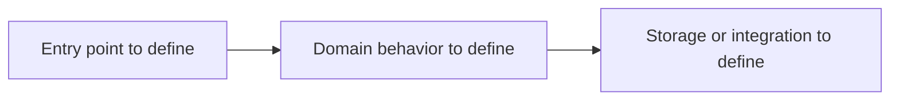

# Architecture

Status: not yet established. This file describes the current system once implementation exists.

## Logical diagram

This is an unconfigured placeholder. Replace it with the project's real component responsibilities during design, and label proposals until implemented.

## System and ownership

TBD: main components, their responsibilities, and the dependencies between them.

## Runtime and data flow

TBD: entrypoints, persistence, integrations, background work, and error handling.

## Boundaries and invariants

TBD: authorization, data ownership, public interfaces, and other rules that must hold.

## Development and operations

TBD: link setup instructions from the root README and exact checks from the workflow profile.

## Decisions

Link significant [decision records](decisions/README.md). Feature-specific proposals belong in their technical specifications until adopted.
