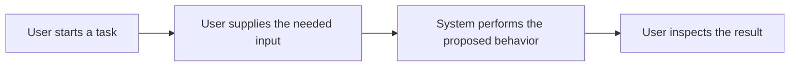

# User flow

Status: unconfigured. Replace this placeholder during product definition. Show the user journey and important failure or review paths.

Keep this diagram aligned with the PRD and feature requirements. See [architecture](ARCHITECTURE.md) for component responsibilities.
