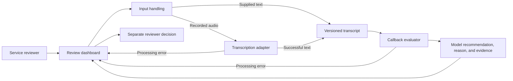

# Proposed architecture

Current state: documentation-only repository. No application, API integration, database, or deployed service exists. The diagram describes logical responsibilities, not selected frameworks or deployment units.

The callback evaluator receives the transcript version selected for the decision. Evidence must point to that version. Original text, a corrected version, the model recommendation, and the reviewer decision remain distinguishable.

Golden labels are part of a separate [evaluation flow](EVALUATION.md). They do not enter classifier inputs.

Frameworks, model providers, persistence, background execution, and deployment remain open under D-003 in the [brief](../intake/PROJECT_BRIEF.md). A later technical specification will settle those choices and failure handling before application implementation.

Update this diagram when the implemented structure changes. Keep proposed components labeled until they exist.
