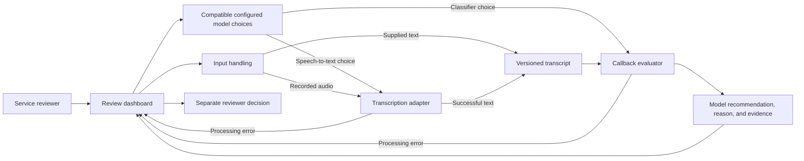
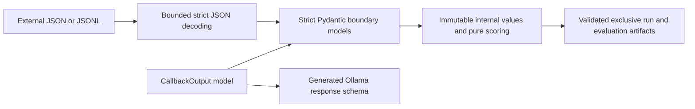
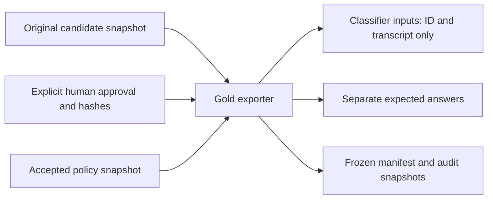
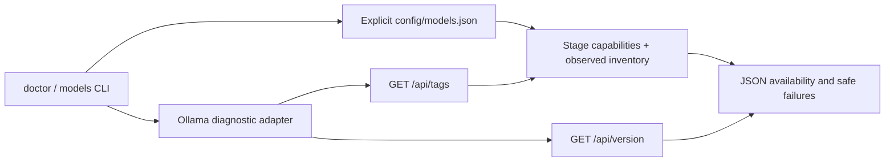
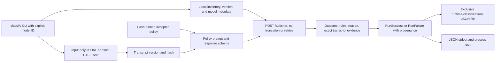

# Architecture

Current state: policy documents, synthetic candidates, an explicit human-approval ledger, frozen gold v1.0, and offline validation/export tools. F-004 batches 1 and 2 add diagnostics, local text classification, and exclusive JSON run records. Batch 3 adds isolated evaluation artifacts and offline scoring. Audio, dashboard, and deployment remain planned. The first diagram describes the proposed full application.

The adapters use independent model selections and record runtime, model identity, and settings per stage. Text classification is implemented through Ollama; speech-to-text remains unimplemented. The classifier requests unloading after each run. Sequential audio-to-text resource handoff remains a later integration check. See [local model options](LOCAL_MODEL_OPTIONS.md).

The callback evaluator receives the transcript version selected for the decision. Evidence must point to that version. Original text, a corrected version, the model recommendation, and the reviewer decision remain distinguishable.

Golden labels are part of a separate [evaluation flow](EVALUATION.md). They do not enter classifier inputs.

## Strict external contracts

contracts.py defines strict Pydantic registry, classifier settings, input, response, saved-run, and prediction models. evaluation_contracts.py defines configuration, completion, report, and freeze artifacts. Extra fields and scalar coercion are rejected. The existing bounded JSON decoder rejects duplicate keys and non-finite values before strict Pydantic JSON validation; LF-only JSONL parsing preserves Unicode transcript separators. Validators preserve exact text, accepted policy-rule combinations, and verbatim transcript evidence.

Internal dataclasses and the pure scorer remain independent of the UI and provider SDKs. CallbackOutput is the authoritative response contract used for both validation and schema generation. Rule consistency and exact evidence checks remain application validation after generation; a valid schema does not establish semantic truth or deterministic inference. callback-text-v2 records the generated schema's prompt change. System snapshots include the contract and Pydantic/core versions, and prior artifacts retain their original hashes and source identity.

The [F-004 specification](../features/active/F-004-local-model-pipeline/02_TECHNICAL_SPEC.md) separates the implemented Python/Ollama classifier from proposed faster-whisper transcription and Streamlit dashboard. The owner selected qwen3.5:4b-q4_K_M under D-003 in the [brief](../intake/PROJECT_BRIEF.md). Audio dependencies and GPU handoff remain implementation checks; deployment is outside this feature.

Update this diagram when the implemented structure changes. Keep proposed components labeled until they exist.

## Implemented offline data flow

The application diagram above remains proposed. The implemented exporter validates approval against both the candidate and policy hashes and preserves an existing differing release.

## Implemented batch 1 diagnostics

The package lives under src/voice_callback. domain.py defines transcript versions, stage-specific model configuration, immutable settings, three policy outcomes, run provenance, and distinct success/failure variants. models.py validates the registry and joins exact Ollama tags with observed digests. ollama.py restricts bounded HTTP requests to loopback; diagnostic commands remain read-only. cli.py renders JSON and exit codes. Business contracts do not depend on a UI or provider SDK.

Configured capabilities do not prove installation or inference. Faster-whisper availability is explicitly unverified. No classifier default is configured. See [local setup](LOCAL_SETUP.md) for executable commands, state meanings, and limits.

## Implemented batch 2 text classification

classify.py owns prompt construction and validation. The transcript is data in a separate user message. Expected answers are rejected by the JSONL reader. storage.py serializes immutable domain values and creates each record exclusively. Model identity is checked before and after a successful inference. A malformed response, context overflow, timeout, or resource error cannot contain a successful policy label. Semantic correctness of otherwise valid reasons remains an evaluation question.

## Implemented batch 3 evaluation

```mermaid
flowchart LR
    CLI["evaluate CLI"] --> Split["datasets.py validates manifest and input-only split"]
    Split --> Config["evaluation_config.py snapshots the exact local system"]
    Config --> Runner["evaluate.py invokes existing classifier per case"]
    Runner --> Records["Exclusive run records and closed predictions"]
    Records --> Marker["Inference completion and integrity hashes"]
    Marker --> Answers["Separate reference-answer read"]
    Answers --> Scorer["scoring.py computes counts and explicit denominators"]
    Records --> Scorer
    Scorer --> Report["Immutable report and offline rescore"]
    Report --> Freeze["Explicit candidate freeze for later held-out use"]
```

json_io.py supplies strict duplicate/non-finite rejection and LF-only JSONL parsing to both classification and evaluation. classify.py exposes pure request construction with prompt/request hashes so evaluation reuses the actual classifier configuration. There is no second classifier prompt. Scoring depends on typed predictions and reference answers, not on Ollama or a UI. Inference completion is persisted before the scorer can open answers. Configuration drift or incomplete inference leaves inspectable artifacts without a quality report. Held-out execution requires a matching frozen system and explicit opt-in.
