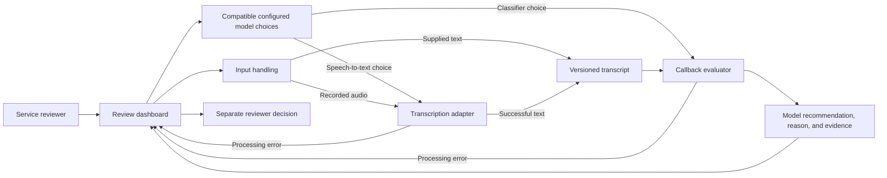
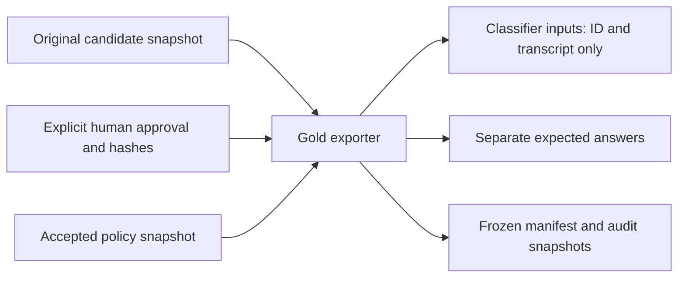
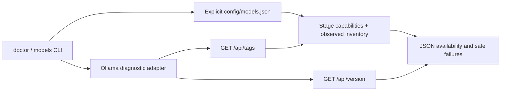

# Architecture

Current state: policy documents, synthetic candidates, an explicit human-approval ledger, frozen gold v1.0, and offline validation/export tools. Batch 1 adds a Python diagnostics package and read-only local Ollama API integration. Inference, the dashboard, storage, and deployment remain planned. The first diagram describes proposed application responsibilities.

The proposed adapters use independent model selections and record runtime, model identity, and settings per stage. For this laptop, sequential execution with GPU memory release is recommended. Local Ollama is installed; speech-to-text runtime setup and inference remain unimplemented. Read-only diagnostic integration is described below. See [local model options](LOCAL_MODEL_OPTIONS.md).

The callback evaluator receives the transcript version selected for the decision. Evidence must point to that version. Original text, a corrected version, the model recommendation, and the reviewer decision remain distinguishable.

Golden labels are part of a separate [evaluation flow](EVALUATION.md). They do not enter classifier inputs.

The [F-004 specification](../features/active/F-004-local-model-pipeline/02_TECHNICAL_SPEC.md) now proposes a Python core, local Ollama classifier, faster-whisper transcription, Streamlit dashboard, and local run artifacts. Classifier selection remains deferred under D-003 in the [brief](../intake/PROJECT_BRIEF.md). Dependency verification and actual GPU behavior remain implementation checks; deployment is outside this feature.

Update this diagram when the implemented structure changes. Keep proposed components labeled until they exist.

## Implemented offline data flow

The application diagram above remains proposed. The implemented exporter validates approval against both the candidate and policy hashes and preserves an existing differing release.

## Implemented batch 1 diagnostics

The package lives under src/voice_callback. domain.py defines transcript versions, stage-specific model configuration, immutable settings, three policy outcomes, run provenance, and distinct success/failure variants. models.py validates the registry and joins exact Ollama tags with observed digests. ollama.py restricts bounded, read-only HTTP requests to loopback; cli.py renders diagnostics and exit codes. Business contracts do not depend on a UI or provider SDK.

Configured capabilities do not prove installation or inference. Faster-whisper availability is explicitly unverified. No classifier default is configured. See [local setup](LOCAL_SETUP.md) for executable commands, state meanings, and limits.
