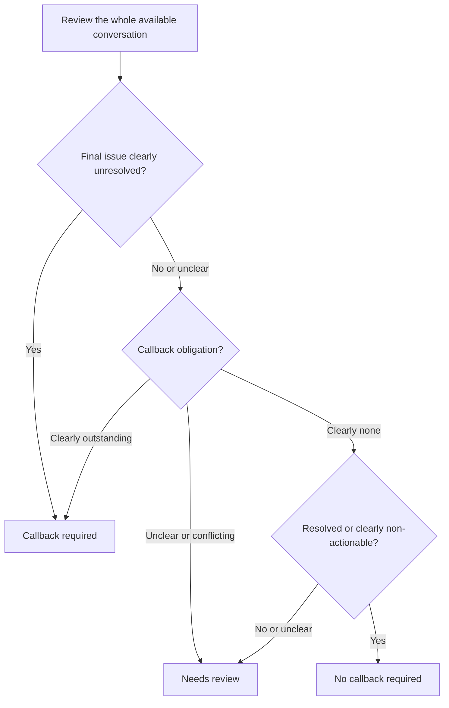

# Callback policy v1.0

Status: accepted for this prototype.
Decision owner: the user.
Accepted: 2026-11-05.
Sources: SRC-009 and SRC-010 in the [source register](../intake/README.md).

Classify the final known conversation state. A statement that an issue was unresolved earlier does not override a later clear resolution.

| Rule | Outcome | Accepted condition |
| --- | --- | --- |
| UR-001 | callback_required | The service issue remains explicitly unresolved, even without a callback request or promise. |
| CB-002 | callback_required | The caller has an outstanding explicit request for a callback. |
| CB-003 | callback_required | The representative has an outstanding promise to call back. |
| NC-001 | no_callback | The issue is resolved and no follow-up remains. |
| NC-002 | no_callback | The call is clearly non-actionable spam or a wrong number. |
| NC-003 | no_callback | An issue unresolved earlier is resolved before the call ends, with no separate callback request or promise outstanding. |
| NR-001 | needs_review | Incomplete, unintelligible, or contradictory conversation leaves the resolution or follow-up obligation unclear. |

A resolved issue can still require a callback when a separate request or promise remains outstanding. Missing contact details do not erase a clear callback obligation.

## Decision flow

These questions concern evidence in context. They are not keyword matching rules. Processing failures remain processing errors and never become a no-callback recommendation.

## Policy examples

These fictional examples illustrate accepted rules. Newly authored examples are development material, not independent held-out test results.

| ID | Conversation | Expected outcome | Rule |
| --- | --- | --- | --- |
| POLICY-001 | Caller: "My issue is still unresolved." Representative: "I'll pass that to the team." | callback_required | UR-001 |
| POLICY-002 | Caller: "Please call me back about the appointment." | callback_required | CB-002 |
| POLICY-003 | Representative: "I will call you tomorrow with the update." | callback_required | CB-003 |
| POLICY-004 | Caller: "That answers my question. Nothing else is needed." | no_callback | NC-001 |
| POLICY-005 | Caller: "I dialed the wrong business. Sorry, goodbye." | no_callback | NC-002 |
| POLICY-006 | Caller: "It was unresolved this morning. Your explanation has fixed it now; no further help is needed." | no_callback | NC-003 |
| POLICY-007 | Caller: "I was calling about my appointment..." Recording ends. | needs_review | NR-001 |
| POLICY-008 | Caller: "The question is answered, but please still call me tomorrow to confirm." | callback_required | CB-002 |
| POLICY-009 | Caller: "It is resolved and it is not resolved." No clarification follows. | needs_review | NR-001 |

Use the [label guide](LABEL_GUIDE.md) when reviewing candidate data. Changes to accepted rules require a recorded policy version change; a candidate model's disagreement does not change the expected answer.
