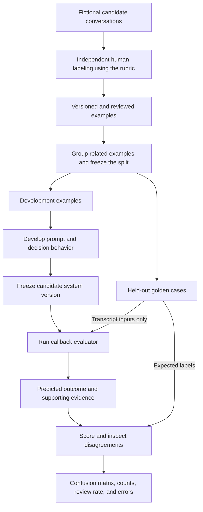
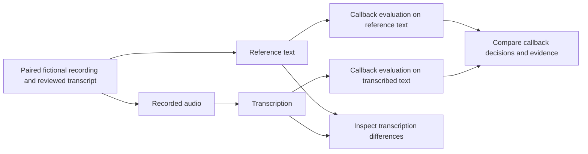

# Proposed evaluation flow

Status: design proposal. No dataset is accepted as gold, and no evaluation has run. The [PRD](PRD.md) owns the rubric, metrics, and acceptance decisions.

The reference answers reach the scorer. They do not reach the callback evaluator. Do not revise a gold label merely because the candidate disagrees; a justified labeling correction creates a new dataset version.

## Add audio after the text baseline

Comparing both paths helps distinguish decision errors from transcription-induced errors. An audio failure stays visible as a processing failure. There are no quality or performance results to report at this stage.
