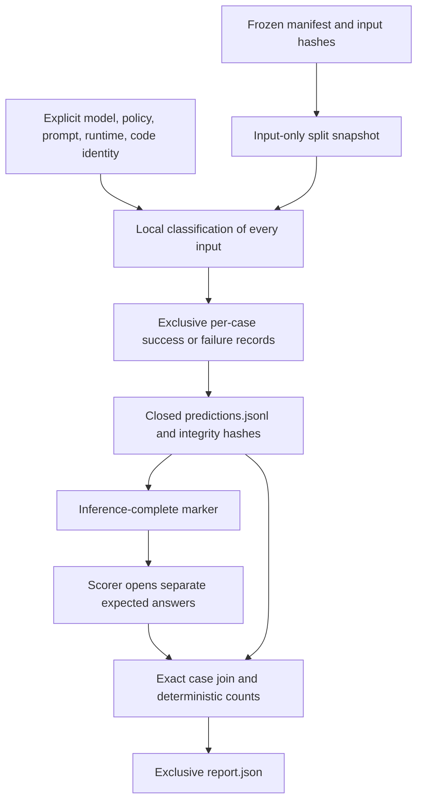
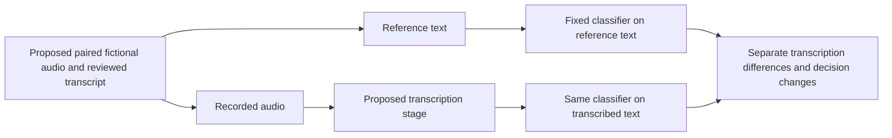

# Text evaluation

Status: batch 3 implements a development runner, immutable artifacts, deterministic offline scoring, and candidate configuration freezing. The first development baseline matched all 20 reference labels. Strict Pydantic boundary contracts are implemented and verified offline; a fresh development baseline now precedes candidate freeze. The frozen release has 20 development and 20 held-out evaluation cases. The [PRD](PRD.md) owns the rubric and acceptance decisions.

## Development checkpoint before contract migration

The owner ran evaluation 7f31782d-c234-4937-85fe-252add830d39 on clean commit 1f94357 with callback-text-v1 and the selected Qwen digest. Offline rescore reproduced 20/20 valid and correct outputs: callback recall 8/8, precision 8/8, needs-review rate 6/20, and no processing failures or unsafe misses. Original reports remain in the ignored reports/text directory; their hashes and full revision are recorded in the [implementation plan](../features/active/F-004-local-model-pipeline/03_IMPLEMENTATION_PLAN.md). Copy that directory separately when preserving evidence across machines; ignored artifacts are not included in the Git commit.

One fictional development trial establishes neither held-out quality nor repeatability. Preserve that evidence. The approved strict Pydantic contract migration has passed offline checks. Commit the verified implementation and run a fresh development baseline before configuration freeze. The generated response schema requires callback-text-v2 and a new prompt/source fingerprint. Existing reports are not rewritten or presented as migrated runs; offline rescoring uses the original matching source revision.

## Run development inference before scoring

```powershell
.venv\Scripts\python.exe -m voice_callback.cli evaluate --split development --model qwen35-4b
```

The runner validates the frozen manifest, exact split IDs, and input-file hash. It reads only ID/transcript records before inference. Each case gets a classification run with its original input version/hash, the selected model identity/settings, and prompt/policy provenance. No answer, rationale, or expected label enters the model request.



A unique directory under reports/text contains configuration.json, evaluation.json, inputs.jsonl, runs/, predictions.jsonl, inference-complete.json, and report.json. All writes preserve prior artifacts. Interrupted inference retains its partial files and an aborted.json marker; it cannot be scored. Configuration drift prevents a completed report. A missing model is never downloaded automatically.

The report records dataset/manifest/input/answer/prediction/system hashes, scorer version, one trial, all-case totals, and inspectable disagreements. A configuration snapshot records the model digest and metadata hash, explicit settings, server version/URL/timeouts, prompt/policy versions and hashes, Git revision/clean state, and Python source-byte fingerprint. Changing code or data prevents silent reuse under the same claimed system.

## Interpret the denominators

| Result | Definition |
| --- | --- |
| Confusion matrix | Three expected-outcome rows by three valid predicted-outcome columns. Processing failures are reported separately by expected label. |
| Strict callback recall | Correct callback predictions divided by all expected callbacks, including cases that failed processing or returned needs_review. |
| Callback precision | Correct callback predictions divided by all valid callback predictions. |
| Needs-review rate | Valid needs_review predictions divided by all input cases, including processing failures. |
| Valid-output coverage | Validated predictions divided by all input cases. |
| Unsafe misses | IDs where callback_required was predicted no_callback. |

Each metric includes its numerator, denominator, and value. A zero denominator produces null, never an invented zero or perfect value. Every frozen input must have exactly one prediction or processing failure. Missing, duplicate, or foreign records are rejected before scoring. Processing failures never become a fourth policy outcome or an implicit needs_review.

The labels are independently owner-approved references. Validation checks output structure and exact evidence locations; it does not prove semantic correctness. Preserve disagreements and inspect their reasons. Do not rewrite a reference merely because a model disagrees. Label corrections require a new dataset version.

## Rescore without inference

```powershell
.venv\Scripts\python.exe -m voice_callback.cli score --run-dir reports/text/RUN_ID
```

Replace RUN_ID with the directory printed by evaluate. Offline scoring verifies completion, coverage, hashes, per-case run bindings, and the source fingerprint before opening answers. An identical report is verified without rewriting it; a differing report is preserved and reported as an error. No model call occurs. Exit 0 means all inputs have valid outputs, exit 1 means a completed report contains processing failures or an I/O/runtime operation failed, and exit 2 means invalid configuration or artifact validation. Incorrect policy predictions remain visible disagreements even when execution exits 0.

## Freeze a candidate before held-out inference

```powershell
.venv\Scripts\python.exe -m voice_callback.cli freeze-evaluation --run-dir reports/text/RUN_ID
```

Freeze requires a complete development report without processing failures, an originally clean committed implementation, and unchanged Python source in a currently clean Git revision. It writes an exclusive frozen-configuration.json bound to the development report, full system snapshot, dataset manifest, and current Git revision. Freezing is reproducibility preparation, not quality acceptance. Use --output to name another artifact rather than replacing a differing freeze.

The held-out path requires both --frozen-config and --allow-held-out with --split evaluation. It also requires the exact frozen code revision/source, model digest and metadata, prompt/policy, settings, runtime, and dataset manifest. Tests exercise this path with a separate synthetic fixture. No real held-out inference is part of the current authorization; the owner selects that action separately after the candidate is frozen.

## Limits of the first baseline

The planned first baseline is one trial of one selected model over 20 fictional development cases, with related conversations grouped together. Report counts alongside fractions. The run can reveal functional failures and development disagreements, but it cannot establish a repeatability spread, a model comparison, a population accuracy estimate, or a performance target. D-004 remains open for the owner's acceptance threshold. A successful small development run is not production approval.

## Future enhancement: paired audio evaluation



SRC-024 defers transcription and paired checks to the [roadmap](ROADMAP.md). This diagram is a future proposal, not a current F-004 acceptance gate. The iterative workspace excludes held-out cases and answers; it does not invoke freeze or held-out evaluation. Gold v1.0 remains unchanged.

## Transport uncertainty and admission

F-006 shares inference admission across CLI/API entrypoints. Evaluation now stops after a timeout/unavailable/HTTP/invalid-transport failure, preserving that failed run/prediction plus aborted.json without a completion marker or quality report. It opens no answers and does not send another case while provider execution is uncertain. Known terminal failures such as validated invalid model output can still be included in a completed report and its denominators. Pure metric definitions are unchanged. After stopping/restarting the runtime, explicitly recover admission before a new run; never infer quiescence from a timestamp or closed client connection. Historical baseline artifacts remain unchanged and require their original source for rescore.

## Evaluation admission observation

The CLI evaluation lease observes each classifier result before persistence or provenance checks. A timeout therefore retains recovery admission even if configuration drift makes later validation fail. Library callers that hold an InferenceLease should bind evaluate's observe_result parameter to lease.observe; the shared CLI does this. Unknown provider completion still aborts before another request or answer read.
