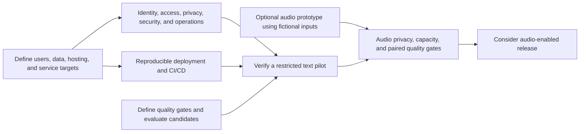
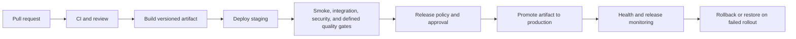

# Technical roadmap

Status: proposed follow-up work, updated 2026-11-08. This is the technical team's planning and handoff reference, not a committed schedule or a production-readiness claim. SRC-024 defers audio; SRC-026 accepts F-004 text delivery after owner testing and QA; SRC-027 requests a broader production-hardening, deployment, and automated CI/CD roadmap.

New work gets a feature document with scope, acceptance criteria, dependencies, and a named owner before implementation. The roles below are proposed responsibility assignments. Feature folders remain the authority for lifecycle status; this roadmap does not silently close other active features.

## Current delivery and remaining gaps

| Area | Implemented evidence | Remaining work |
| --- | --- | --- |
| Text review and inference | Completed F-004 and [F-006](../features/completed/F-006-text-review-workspace/03_IMPLEMENTATION_PLAN.md); versioned transcripts, explicit local classification, exact evidence, separate human decisions, durable SQLite history. | Production identity, authorization, privacy, operational scale, and service commitments. |
| Evaluation | [F-011](../features/completed/F-011-evaluation-workflow/03_IMPLEMENTATION_PLAN.md) provides one command, saved browser reports, and compatible baseline comparison. Current-source v2 development run matched 20/20 fictional labels. | Numeric targets, broader/adversarial evidence, repeatability, explicit candidate freeze, and separately authorized real held-out measurement. |
| Local security | Loopback binding, origin checks, mutation nonce, request limits, strict contracts, and framing controls. [F-010](../features/active/F-010-local-security/FEATURE.md) records narrow local/fixture security work. | Login, server-side case access controls, hosted security design, and security verification. A workspace nonce is not user authentication. |
| Telemetry | [F-009](../features/active/F-009-langfuse-tco/03_IMPLEMENTATION_PLAN.md) and [Langfuse setup](LANGFUSE.md) document optional model traces and metadata-only mode. Run provenance is saved locally. | Application/security audit logs, metrics, alerts, retention, access controls, and operational response. Traces do not replace these. |
| CI and delivery | Shared quality runner, staged/committed preflight, pinned dependencies/actions, Python matrix, and production-stack browser checks in [CI](../.github/workflows/ci.yml). | Deployment pipeline, environment protections, immutable release artifacts, rollback, migration controls, and verification in a deployed environment. Configured CI is not CD or proof that a given hosted run passed. |
| Audio | Deferred by [ADR-002](decisions/ADR-002-defer-audio.md). Registry metadata is not a transcription service. | Upload boundary, transcription provider/runtime, job lifecycle, privacy, capacity, and paired evaluation. |

## Proposed delivery order

The proposed first release boundary is a restricted text pilot. Audio experiments can use fictional inputs in parallel, but accepting real recordings or exposing new upload routes adds privacy, security, and capacity requirements. Production deployment follows explicit scope and readiness evidence.

## Decisions the team needs first

| Decision | Proposed owner | Required output |
| --- | --- | --- |
| Intended use and release boundary | Product owner | Demo, restricted internal pilot, or external service; users, supported workflows, expected volume, and human responsibility for callback decisions. |
| Identity and access model | Product and security leads | Identity provider/SSO, account enrollment and removal, roles, case ownership, and whether multiple teams or firms share the service. |
| Data and privacy | Data owner and security lead | Fictional versus real calls; approved collection/processing, storage region, retention/deletion, transcript/audio access, and allowed telemetry destinations. Obtain applicable recording/consent requirements before real-audio use. |
| Quality and workload targets (D-004) | Product and ML leads | Required callback recall, acceptable unsafe misses/failures and review workload, sample size, representative scenarios/languages, and release evaluation protocol. |
| Deployment topology (D-005) | Platform and backend leads | Local appliance, internal host, or cloud; where Ollama/transcription runs; GPU model/availability; network boundaries and supported client access. |
| Operating targets and ownership | Platform and support leads | Latency, throughput, availability, capacity/cost budget, data-loss and recovery-time targets, support hours, incident contacts, and release authority. |

## Production-hardening workstreams

These are proposed work packages. Each row includes a concrete verification outcome to turn into feature acceptance criteria.

| Workstream | Proposed responsibility | Work and verification outcome |
| --- | --- | --- |
| Login and session lifecycle | Frontend, backend, security | Integrate the chosen identity provider, appropriate MFA, secure session handling, expiry, logout/revocation, and account removal. Verify anonymous access rejection, expired sessions, logout, and identity-provider failure. |
| Authorization and data isolation | Backend and security | Enforce server-side permissions on case/version/job/run/review reads and writes, exports, and administration. Define reviewer/admin roles and team or tenant ownership. Verify another user's guessed IDs and cross-team access are denied. |
| Logging and audit | Backend and platform | Add structured request/job/run correlation, actor/action/resource audit events, safe error diagnostics, authentication and access-denial events. Define redaction, retention, restricted access, and log-injection defenses. Verify errors can be traced without exposing secrets or raw call content. |
| Monitoring and response | Platform and ML | Track failure rate, queue wait, inference latency, resource use, model/runtime health, and trace delivery separately. Set dashboards, actionable alerts, runbooks, and incident ownership. Exercise runtime outage and alert delivery. |
| Rate limits and resource protection | Backend and platform | Define per-user/team request limits, bounded queues, inference concurrency, upload sizes/durations, timeouts, cancellation, and quotas. The current one-inference lease is not a per-user rate limiter. Verify overload yields defined backpressure, fair admission, and recovery without duplicate work. |
| Prompt injection and AI security | ML and security | Treat transcripts and future speech as untrusted content. Keep instructions separate, constrain model permissions, retain output/evidence validation and human decisions, and test adversarial instructions and fabricated evidence. A structurally valid response can still be manipulated; prompt wording alone is insufficient. Verify behavior against a versioned adversarial development set without tuning on held-out answers. |
| Application and network security | Security and platform | Threat-model browser/API/model/storage boundaries. Review TLS, trusted proxies, cookies, CSRF/CORS, CSP, XSS/output rendering, injection, SSRF, dependency exposure, and internal model endpoints. Verify authorization and network boundaries with focused tests and an independent security review. Existing framing CSP is only one control. |
| Privacy and secrets | Data owner, security, platform | Minimize sensitive content, define encryption and key management, secret rotation, telemetry consent/configuration, and retention/deletion across databases, reports, audio, traces, and backups. Verify redaction and deletion workflows using fixtures. Keep credentials out of artifacts and logs. |
| Persistence and recovery | Backend and platform | Choose SQLite versus a service database against the agreed concurrency/durability needs. Define schema migrations, backup/restore, storage limits, export/deletion, and recovery from crashes or partial work. Restore a backup and verify cases, versions, reviews, and provenance. |
| Job reliability and scale | Backend and platform | Define worker ownership, bounded durable queueing, retry policy, idempotency, cancellation, stale-job recovery, and model capacity. Verify restarts, duplicate requests, unavailable inference, and sustained target load without duplicate decisions. |
| Model and data governance | ML and product | Version policy/prompts/models/datasets, expand representative and adversarial cases, track errors/drift, and require explicit candidate comparisons. Define human escalation and model rollback. Preserve gold approvals and keep expected answers outside inference. |
| User workflow and accessibility | Frontend and product | Add permission/session-expiry states, clear overload and cancellation recovery, accessible evidence review, and predictable long-running jobs. Verify keyboard/screen-reader use and supported desktop/narrow browser flows. |
| Supply chain and release security | Platform and security | Review dependency/model licenses, vulnerability and secret scanning, artifact inventories/SBOMs, trusted build sources, and patch ownership. Define severity/exception rules and verify a vulnerable or secret-containing change is blocked by the agreed gate. |

Login and authorization are separate: identifying a reviewer does not establish which cases they may access. Application security and AI security also need separate evidence. These workstreams adapt [OWASP API Security risks](https://api-security.owasp.org/editions/2023/en/0x00-header/) and [prompt-injection guidance](https://genai.owasp.org/llmrisk/llm01-prompt-injection/) to this application's proposed hosted boundary. This roadmap is not a completed security assessment.

Logging design follows the [OWASP Logging Cheat Sheet](https://cheatsheetseries.owasp.org/cheatsheets/Logging_Cheat_Sheet.html): collect useful security events while excluding credentials and sensitive content, sanitize event fields, and verify collection and access controls. Existing optional content traces require a separate privacy decision before real-call use.

## Deployment and automated CI/CD

The repository has automated CI checks. It has no documented automated deployment pipeline. Define the following before implementing CD; no cloud vendor, identity provider, database migration, infrastructure purchase, or deployment is selected by this roadmap.

| Definition | Proposed decision and acceptance evidence |
| --- | --- |
| Environments and infrastructure | Identify development, staging, and production hosts/accounts, regions, DNS, TLS, firewall/ingress rules, private model access, durable storage, GPU/runtime provisioning, and infrastructure ownership. Recreate an environment from versioned infrastructure/configuration. |
| Build and release artifact | Choose deployment packaging for Next.js, Nginx, FastAPI, and model runtime. Pin compatible versions and build once with a recorded commit and artifact digest. Promote the same verified application artifact across environments. Pin model/prompt/policy identities independently. |
| Configuration and secrets | Define per-environment non-secret configuration, secret-store access, rotation, and short-lived CI credentials where supported. Keep local `.env` out of release artifacts. Verify missing configuration fails safely and deployment logs reveal no credentials. |
| CI triggers and required checks | Define PR and main/tag/release triggers, required lint/types/tests/data/docs/package/browser/security gates, and review rules. Configure repository enforcement where the hosting plan supports it. A model-quality gate needs a defined dataset, threshold, runtime budget, and approval policy; do not add live inference to ordinary CI by accident. |
| Staging deployment | Define who or what triggers staging, least-privilege runner access, environment isolation, fixture/seed data, schema migration order, health/readiness checks, and post-deploy smoke tests. Verify the deployed browser/API and model connectivity. |
| Production promotion | Define version/tag strategy, release approver, environment protection, change record, release notes, promotion criteria, and rollout strategy. Begin with controlled production promotion after staging evidence; automate additional steps only under an agreed policy. |
| Migrations and rollback | Define backups and backward-compatible database changes, application/model rollback, failed-deploy handling, and data restoration when rollback is unsafe. Rehearse a failed release and demonstrate recovery to the agreed targets. |
| Release observability | Record deployed commit/artifact/model versions, deployment events, error/latency/capacity signals, and alert thresholds. Assign on-call/incident ownership and document when to stop or reverse a rollout. |
| Cost and capacity | Estimate GPU/runtime/storage/telemetry/CI costs, peak load, scaling constraints, and spending limits. Validate the proposed footprint with representative workload before assigning service targets. |

This diagram is a proposed delivery workflow. Current local/CI commands are in [quality checks](QUALITY_CHECKS.md); hosting remains D-005 in the [project brief](../intake/PROJECT_BRIEF.md).

## Model-quality and release follow-up

SRC-026 accepts F-004's retained text delivery after owner testing and QA. The fresh callback-text-v2 development baseline is recorded in the [closeout evidence](../features/completed/F-004-local-model-pipeline/03_IMPLEMENTATION_PLAN.md#owner-qa-closeout-src-026-2026-11-08). Remaining activities are separate from that completed delivery:

- Define numeric decision-quality, review-workload, and latency targets under D-004 before claiming fitness for a defined production use. Expand representative development data and measure repeatability; 20 fictional development cases do not establish those targets.
- Inspect the selected development candidate and explicitly freeze its configuration before a real held-out evaluation. The freeze command exists; no actual freeze is claimed in the closeout.
- Run real held-out evaluation only with separate owner authorization and a matching frozen configuration. The guarded path has synthetic verification; no real held-out result is recorded. Define how a failed held-out result is handled without repeatedly tuning against the same reserved set.
- Define candidate comparison and release evidence for model/prompt/policy changes, then monitor production feedback without silently changing gold labels.

The [evaluation guide](EVALUATION.md) documents commands and artifact boundaries. A model release and an application deployment require their respective evidence.

## Audio upload and voice-to-text

Status: deferred under SRC-024. No delivery date, model, provider, or service architecture is approved. See [ADR-002](decisions/ADR-002-defer-audio.md).

| Future scope | Definition and evidence needed |
| --- | --- |
| Upload and storage | Supported file formats, actual-content validation, size/duration limits, malicious-file handling, access controls, storage location, retention, and deletion. Verify malformed, oversized, unsupported, silent, and interrupted uploads. |
| Transcription service | Local versus hosted processing, model/provider and license, hardware/cost fit, languages, timeouts, retries, cancellation, and durable job status. Verify runtime failure and recovery without fabricating a transcript. |
| Review and provenance | Keep original audio, generated transcript, reviewer correction, transcript version, model identity/settings, and timestamps distinguishable. Bind callback evidence to the exact text used for classification. Define whether speaker attribution or time-aligned playback is needed. |
| Paired quality | Use consented or fictional recordings with reviewed reference text. Measure transcription errors separately from downstream callback mistakes, including noise, accents, silence, and supported languages. Evaluate adversarial spoken instructions as untrusted data. |
| Release boundary | Complete the applicable identity, privacy, upload security, monitoring, rate-limit, capacity, and deployment gates before enabling real recordings in a pilot. |

F-004-AC08, F-004-AC10, and the transcription-selection part of F-004-AC02 are deferred here, not completed. Existing transcription registry entries remain unverified and do not provide transcription.

## Technical-team handoff

Start by assigning owners to the decisions above and selecting a bounded text-pilot scope. Convert the first work packages into backlog features with measurable acceptance criteria. Track implementation in those features, keep this roadmap as the shared future direction, and link release evidence before changing readiness claims. No dates or production commitments are assigned by this document.
