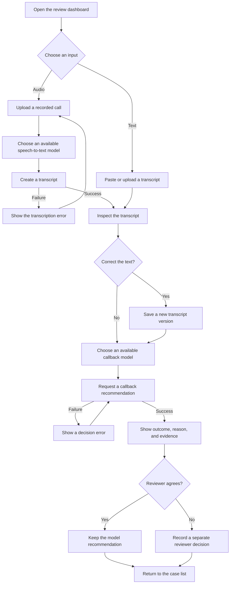

# Proposed user flow

Status: product proposal. No screen or interaction has been implemented.

The model choices are independent; a compatible multimodal model may serve both stages. Unavailable choices are reported before execution. Text input does not require a speech-to-text model. Each run records both the transcript version and the model configuration used.

The outcome can be callback required, no callback required, or needs review. Transcription and decision failures are processing errors, not no-callback results. A reviewer decision does not silently change the expected label of a golden case.

The [PRD](PRD.md) owns the behavior and acceptance requirements. [Architecture](ARCHITECTURE.md) shows the proposed logical components.
