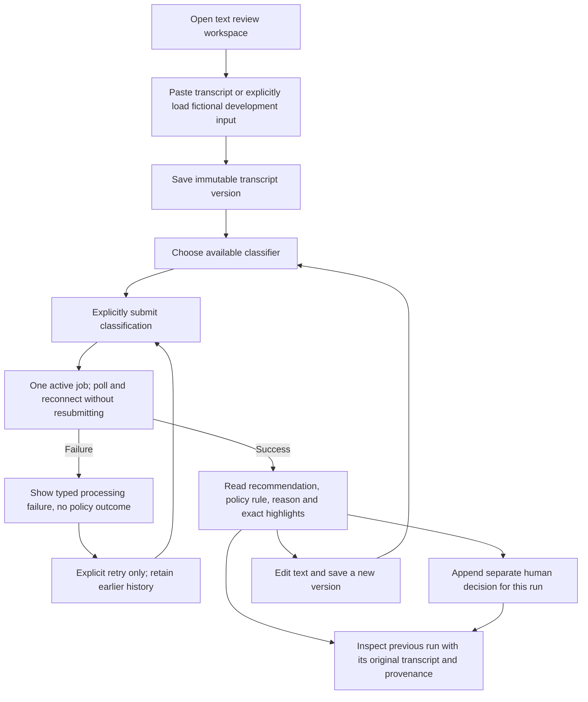
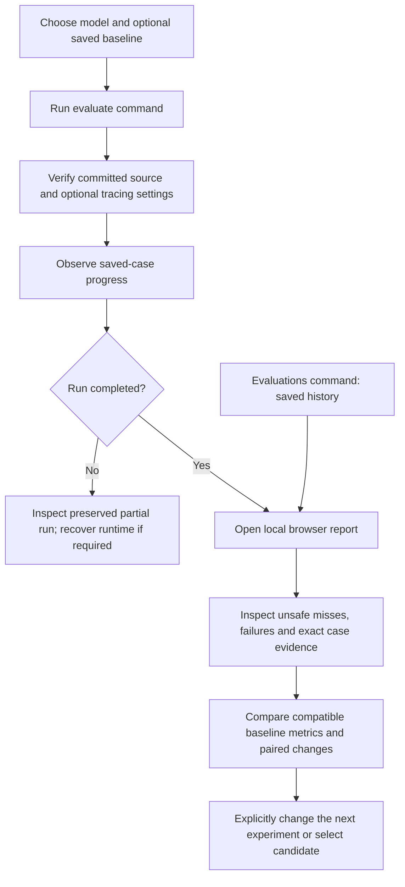

# Reviewer flow

Status: F-006 implements the local production text workspace and verifies its browser/API flow with a controlled Ollama HTTP fixture. SRC-024 defers audio to the [roadmap](ROADMAP.md).

Changing a selector/filter/case, saving text, inspecting history or recording human review never starts inference. The displayed evidence belongs to the selected run's original transcript, even after a newer edit. A human decision never replaces the model output or modifies gold. Empty, running, timeout, malformed-output and unavailable-runtime states have explicit recovery; processing errors are not needs_review policy outcomes.

Development examples are input-only; the iterative UI excludes held-out cases and answers. Formal evaluation remains separate. The [PRD](PRD.md) owns product intent; [F-006](../features/completed/F-006-text-review-workspace/01_REQUIREMENTS.md) owns browser/API acceptance; [F-004](../features/active/F-004-local-model-pipeline/01_REQUIREMENTS.md) owns core text evaluation.

## Development evaluation review

This is separate from reviewing one service call. The F-011 first slice is a command
and local readable report, rather than an additional app page.

Reviewing a saved report starts no model or tracing request. Expected answers appear
only in completed development reports, after inference. Candidate freezing remains
an explicit command; held-out execution requires its original separate opt-in.
