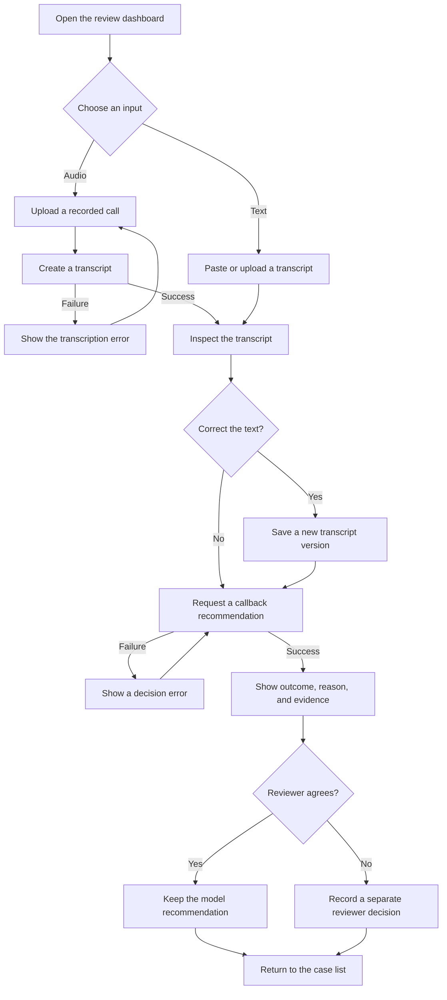

# Proposed user flow

Status: product proposal. No screen or interaction has been implemented.

The outcome can be callback required, no callback required, or needs review. Transcription and decision failures are processing errors, not no-callback results. A reviewer decision does not silently change the expected label of a golden case.

The [PRD](PRD.md) owns the behavior and acceptance requirements. [Architecture](ARCHITECTURE.md) shows the proposed logical components.
