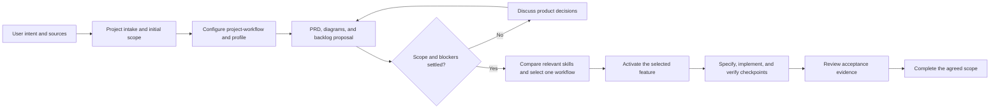

# Workflow and skill selection

Stage: accepted policy and frozen owner-approved gold v1.0; no model evaluation has run. This project has its own local Git repository under projects.

## Orchestrator and timing

The project-specific [project-workflow](../.agents/skills/project-workflow/SKILL.md) skill is the entrypoint for substantive tasks. It reads the [workflow profile](../.codex/workflow-profile.md), discovers relevant available skills, chooses one execution workflow, and coordinates the applicable checks.

Create and configure this orchestrator during intake, after identifying the project type and initial scope, before implementation. Revisit choices as the scope, stack, or risks change. The first draft had a profile without this project entrypoint; the user's feedback made this missing step explicit, and it is now included in both this project and the starter.

The bundled project-intake skill handles startup and source gathering. The creator script copies files. The profile owns project facts and exact checks. The orchestration skill coordinates these resources and other skills; no application agent service has been built.

## Selected skills

| Role | Skill | Current use |
| --- | --- | --- |
| Project orchestration | Bundled `project-workflow` | Discover, compare, select, coordinate, and verify project work. |
| Intake execution | Bundled `project-intake` | Skeleton, sources, brief, PRD, profile, and first backlog proposal. |
| Discovery support | Installed `workflow-skill-manager` | Narrow relevant candidates and apply the repository profile. |
| Documentation | Pstack `technical-writing` and `unslop` | Requirements, diagrams, and explanations. |
| Review | Installed `code-review-workflow` | Source fidelity, scope, consistency, and handoff review. |
| Verification and Git handoff | Installed `verification-before-completion` and `branch-finish` | Actual artifact checks and the local intake commit. |

The two bundled skills travel with the repository. Other names describe the current authoring environment, not automatic installation elsewhere.

## Candidate comparison

| Task | Candidates inspected | Choice and reason | Actual execution |
| --- | --- | --- | --- |
| Initial product definition | Project-intake; pstack in-your-own-words, sharpen, technical-writing, and unslop | Use intake plus pstack writing skills. Intake produces the requested artifacts; prompt rewriting alone does not replace a PRD. | Draft source register, brief, PRD, diagrams, and backlog proposal created. No product acceptance claimed. |
| Later application feature | House planning-workflows and pstack Feature | Choice deferred until the feature and its risks are specified. Reinspect then; no automatic preference for either source. | Inspected as candidates; neither executed to build the application. |
| Later uncertain architecture | Relevant house design skills and pstack architect | Compare when there is a concrete design question. | Not executed. |

For each substantial task, read the relevant pstack candidate and our candidate before choosing. Record the reason, unavailable prerequisites, and actual results in the feature plan or this record. Full playbooks and adaptations remain distinguishable.

No application-specific preflight runner, framework, model provider, transcription API, or hosting is selected.

## Read-only routing trial

An independent agent used this skill and repository to respond to a request for the next small policy-planning step before coding. It selected project-intake with pstack in-your-own-words and technical-writing, inspected sharpen, and explained why prompt rewriting was insufficient for this product decision. It kept F-001 in backlog and proposed resolving D-001 through fictional boundary cases.

The trial changed no files and ran no application or model evaluation. It supports the routing behavior for this one scenario, not general superiority or correctness of all future choices.

## Follow the lifecycle

Current state: F-001 through F-003 are completed. Golden set v1.0 contains 40 owner-approved labels; the wider application PRD remains a draft. F-001 is a small documentation feature, so it uses one file. A substantial application feature will use three documents.

The user selected audio and text inputs, text-first decision evaluation, diagrams, project orchestration during intake, and relevant pstack consideration. Callback policy is accepted. Dataset review/freeze is complete for v1.0. Stack and quality thresholds remain open.

## Accepted policy and candidate preparation checkpoint

The user accepted callback policy v1.0 (SRC-010). F-001 completed the policy, human labeling guide, and proposed 40-case preparation plan. Independent review found and confirmed the fix for the diagram's uncertain-obligation path. For F-002, planning-workflows was selected after inspecting pstack Feature; the fixed data contract needs bounded preparation rather than competing application architectures. Pstack writing skills support the documents. No full pstack Feature run is claimed.

## Candidate preparation result

F-002 completed 40 fictional cases, a reproducible review packet, and offline validation tools. All 12 behavior tests passed. Independent agent QA found no semantic mismatch across the 40 cases. Every record remains pending, with null reviewer and reviewed label. This is candidate preparation, not human gold approval or model evaluation. F-003 tracks the next human review and freeze step.

## Human approval and gold-freeze checkpoint

The owner explicitly approved all 40 proposed labels as-is after approval scope was clarified (SRC-011). F-003 used bounded house planning and pstack writing support; full pstack Feature was inspected but not executed. An independent review found missing policy binding in the exporter. A regression reproduced the issue, the approval was bound to the accepted policy version/hash, and follow-up review confirmed resolution. All 22 tests passed. The release preserves original proposals, separate approval, isolated inputs/answers, grouped frozen splits, and artifact hashes. No model result is claimed.
