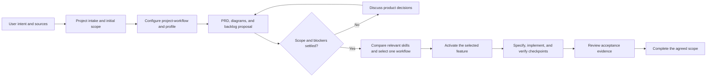

# Workflow and skill selection

## F-008 committed-review corrections

project-workflow selected house systematic-debugging for six reproduced failures, with focused TDD regressions and independent code-review-workflow checks. Wider blast-radius investigation was considered but the committed review already established concrete triggers. The owning boundaries were corrected without a new design: evaluation lease observation, worker recovery, private launcher PID paths and frontend save/reconnect/poll state. All six regressions failed on the old behavior and passed after correction; full gates and publication evidence live in [F-008](../features/completed/F-008-review-desk-reliability/FEATURE.md). The owner authorized commit/push/PR review and asked to exclude local analysis and generated screenshots. Earlier local commits are preserved; publication uses an equivalent clean-tree commit based on main so PNGs are absent from the remote history.

## F-007 prompt asset extraction

Under SRC-023, project-workflow retains house planning-workflows as lead for the agreed bounded refactor. Compared architect; another design arena is unnecessary for the selected exact extraction. Code-quality and focused compatibility/source identity/package checks support implementation. A read-only code-review-workflow reviewer checks the independent package/provenance surface while the owner maintains documentation and runs gates. Preserve this branch, the rendered callback-text-v2 prompt/request and all stored runs/reviews. No real inference or new freeze is part of this batch. [F-007](../features/completed/F-007-versioned-classifier-prompt/FEATURE.md) records actual results.

Stage: accepted policy and frozen gold v1.0; completed F-004 text pipeline after owner testing and QA acceptance (SRC-026), completed F-006 Review desk, and merged F-011 evaluation workflow. Current-source v2 development evidence is recorded in the evaluation guide. Audio, actual candidate freeze, real held-out measurement, numeric production-quality targets, and hosting remain follow-up work.

## Orchestrator and timing

The project-specific [project-workflow](../.agents/skills/project-workflow/SKILL.md) skill is the entrypoint for substantive tasks. It reads the [workflow profile](../.codex/workflow-profile.md), discovers relevant available skills, chooses one execution workflow, and coordinates the applicable checks.

Create and configure this orchestrator during intake, after identifying the project type and initial scope, before implementation. Revisit choices as the scope, stack, or risks change. The first draft had a profile without this project entrypoint; the user's feedback made this missing step explicit, and it is now included in both this project and the starter.

The bundled project-intake skill handles startup and source gathering. The creator script copies files. The profile owns project facts and exact checks. The orchestration skill coordinates these resources and other skills; no application agent service has been built.

## Selected skills

| Role | Skill | Current use |
| --- | --- | --- |
| Project orchestration | Bundled `project-workflow` | Discover, compare, select, coordinate, and verify project work. |
| Intake execution | Bundled `project-intake` | Skeleton, sources, brief, PRD, profile, and first backlog proposal. |
| Discovery support | Installed `workflow-skill-manager` | Narrow relevant candidates and apply the repository profile. |
| Documentation | Pstack `technical-writing` and `unslop` | Requirements, diagrams, and explanations. |
| Review | Installed `code-review-workflow` | Source fidelity, scope, consistency, and handoff review. |
| Verification and Git handoff | Installed `verification-before-completion` and `branch-finish` | Actual artifact checks and the local intake commit. |

The two bundled skills travel with the repository. Other names describe the current authoring environment, not automatic installation elsewhere.

## Candidate comparison

| Task | Candidates inspected | Choice and reason | Actual execution |
| --- | --- | --- | --- |
| Initial product definition | Project-intake; pstack in-your-own-words, sharpen, technical-writing, and unslop | Use intake plus pstack writing skills. Intake produces the requested artifacts; prompt rewriting alone does not replace a PRD. | Draft source register, brief, PRD, diagrams, and backlog proposal created. No product acceptance claimed. |
| F-004 local model pipeline planning | House planning-workflows and pstack Feature; architect inspected as an architecture candidate | House planning leads the requested plan and bounded first batch. Pstack writing supports requirements and diagrams. Full Feature mandates design exploration and delegated implementation beyond this planning task. | Three planning documents and PRD build sequence created. No full pstack Feature or architect playbook executed; no application built at that planning checkpoint. |
| F-004 batch 1 implementation | House planning-workflows; pstack Feature and architect; workflow-skill-manager routing | House planning remains the lead. Shared contracts, registry, HTTP, and CLI form one coupled slice with an agreed spec; full design exploration and delegated implementation add no required outcome here. | One owner activated F-004 after verifying paths, implemented the standard-library package, and verified offline and live diagnostics. Pstack writing guidance supports docs; code-review-workflow and verification-before-completion support self-review and evidence. No full pstack playbook ran. |
| F-004 batch 2 selection and classifier | House planning-workflows; pstack Feature and architect; workflow-skill-manager routing | House planning remains the lead for the existing bounded classifier spec. Selection research resolves the material model choice; competing module prototypes and delegated implementation are unnecessary for this slice. | Re-read all candidates, compared official model tags/cards, obtained explicit owner selection, provisioned only Qwen, and implemented one local classifier with offline/live development checks. Writing, code-quality, error-handling, self-review, verification, and snapshot gates support the lead workflow. Systematic-debugging traced the live context-error wording before its mapping was corrected. No full pstack Feature, architect, or delegated run is claimed. |
| Later uncertain architecture | Relevant house design skills and pstack architect | Compare when there is a concrete design question. | Not executed. |

For each substantial task, read the relevant pstack candidate and our candidate before choosing. Record the reason, unavailable prerequisites, and actual results in the feature plan or this record. Full playbooks and adaptations remain distinguishable.

F-005 supplies scripts/check_project.py and scripts/codex_preflight.py. F-004 implements the Python core and selected Ollama text classifier; SRC-024 defers audio. SRC-020 supersedes Streamlit with F-006 Next.js/Nginx/FastAPI. Hosting is outside its scope.

## Read-only routing trial

An independent agent used this skill and repository to respond to a request for the next small policy-planning step before coding. It selected project-intake with pstack in-your-own-words and technical-writing, inspected sharpen, and explained why prompt rewriting was insufficient for this product decision. It kept F-001 in backlog and proposed resolving D-001 through fictional boundary cases.

The trial changed no files and ran no application or model evaluation. It supports the routing behavior for this one scenario, not general superiority or correctness of all future choices.

## Follow the lifecycle

Historical intake checkpoint: F-001 through F-003 were completed and golden set v1.0 contained 40 owner-approved labels. F-001 used one small-feature document; substantial features use three.

At intake, the user selected audio and text inputs, text-first decision evaluation, diagrams, project orchestration, and relevant pstack consideration. SRC-024 later deferred audio. Callback policy and the dataset freeze are accepted; quality thresholds remain open.

## Accepted policy and candidate preparation checkpoint

The user accepted callback policy v1.0 (SRC-010). F-001 completed the policy, human labeling guide, and proposed 40-case preparation plan. Independent review found and confirmed the fix for the diagram's uncertain-obligation path. For F-002, planning-workflows was selected after inspecting pstack Feature; the fixed data contract needs bounded preparation rather than competing application architectures. Pstack writing skills support the documents. No full pstack Feature run is claimed.

## Candidate preparation result

F-002 completed 40 fictional cases, a reproducible review packet, and offline validation tools. All 12 behavior tests passed. Independent agent QA found no semantic mismatch across the 40 cases. Every record remains pending, with null reviewer and reviewed label. This is candidate preparation, not human gold approval or model evaluation. F-003 tracks the next human review and freeze step.

## Local model build planning checkpoint

SRC-016 makes local inference part of the build. F-004 uses the substantial-feature template: requirements, technical specification, and implementation plan. Batch 1 is model-independent health, registry, and CLI work; later batches add text classification, evaluation, transcription, and dashboard integration. SRC-017 requests the next batch in a GPT-6.1 Sol high chat. Planning documents stay in backlog until that owner begins implementation.

## Local model selection checkpoint

This task uses project-workflow for intake reconciliation and pstack technical-writing for the bounded documentation update. Verification-before-completion supports hardware/API observations and document checks. No application feature or full pstack Feature playbook is executed. Existing house implementation planning is deferred until a model integration feature is specified.

The laptop and local Ollama were inspected against official documentation. The model selectors are recorded as requirements; Whisper large-v3-turbo is recommended for audio, while classifier selection remains deferred. No model was downloaded, no inference was run, and no model-quality result is claimed.

## Human approval and gold-freeze checkpoint

The owner explicitly approved all 40 proposed labels as-is after approval scope was clarified (SRC-011). F-003 used bounded house planning and pstack writing support; full pstack Feature was inspected but not executed. An independent review found missing policy binding in the exporter. A regression reproduced the issue, the approval was bound to the accepted policy version/hash, and follow-up review confirmed resolution. All 22 tests passed. The release preserves original proposals, separate approval, isolated inputs/answers, grouped frozen splits, and artifact hashes. No model result is claimed.

## Batch 1 local diagnostics checkpoint

F-004 moved to active at implementation start after Git status review and exact resolved-path checks. Prior uncommitted documentation was preserved and incoming links were repaired. The package provides model-independent contracts, explicit registry validation, bounded loopback Ollama health/inventory requests, and doctor/models CLI commands. The one-owner throughput checkpoint in the feature plan remains applicable; no subagents or other-chat messages were used.

The first offline run exposed an HTTP/1.0 socket lifecycle bug. Systematic-debugging traced the first error to resetting the timeout after response completion. The adapter now stops at response closure, preserves total deadlines, and rejects premature bodies. Current verification is 49 passing tests, 40-case gold integrity, and live Ollama 0.40.14 with zero installed models. No inference or model-quality claim follows. See the [active plan](../features/completed/F-004-local-model-pipeline/03_IMPLEMENTATION_PLAN.md) for exact commands and remaining batches.

## Batch 3 evaluation workflow

project-workflow reassessed house planning-workflows against pstack Feature, architect, and Eval. House planning leads the existing bounded runner/scorer specification. The pstack Eval workflow's multiple candidates and blinded model judge are not needed for this one-model development baseline. No full pstack playbook is claimed. Explain-the-number guides reporting: one small fictional grouped development split, complete case coverage, explicit denominators, no invented threshold or comparison.

Code-quality, error-handling, testability, self-review, verification-before-completion, branch-finish, and configured preflight support the batch. Under code-review-workflow, one read-only subagent reviews scoring and artifact/freeze boundaries independently while the implementation owner maintains documentation and integration evidence. It does not write shared files or run real inference. This is independent review support, not delegated implementation or a full pstack run.

## Batch 3 contract migration checkpoint

The owner approved strict Pydantic boundary models after the first 20-case development baseline. project-workflow rechecked house planning-workflows, pstack Feature, and architect. House planning remains the lead for preserving existing classifier, scoring, and artifact behavior while replacing repeated shape validation and the hand-maintained response schema. One owner implements the coupled migration. Code-quality, focused behavior tests, review, and verification support it; no full pstack playbook is claimed. The baseline is preserved, and a fresh clean-commit development run must precede candidate freeze. Pydantic provides data-contract validation, not deterministic or semantically correct model inference.

## F-006 design exploration, SRC-020

project-workflow compared house planning-workflows and pstack architect. House planning leads cross-feature requirements, contracts and sequencing; architect's implementation arena is beyond the requested stop-before-production scope. Impeccable supports the visual exploration: Windows .cmd context launcher, init/shape/new-work/Operate/craft-floor references, concept seed, two code-first rendered alternatives, detector and independent finish review. The explicit detailed brief substitutes for routine product confirmation and moves visual choice after rendered alternatives. This is an adapted design exploration, not a claimed full shape/architect/Feature playbook. verification-before-completion supports checks. Actual results live in the F-006 plan; no inference, freeze, held-out evaluation, production stack, publication or deployment ran.

SRC-021 selects A Review desk and authorizes implementation. Reassessed pstack architect against house planning-workflows; house planning remains lead for the already specified boundaries. service-layer-design, error-handling and eng-code-quality support implementation. Full architect/arena is not selected. API/workspace behavior gets synthetic tests and the shared Python quality baseline; no live inference or held-out data.

## F-006 production completion run

The owner's continuation to completion retains house planning-workflows as lead. Impeccable Operate supports the selected A extension, one detector pass, independent fresh-context finish review and design documentation. TypeScript best practices/schema-derived boundary validation support the Next.js client. Actual integration runs the built Next.js, Nginx and FastAPI with the existing classifier pointed at a controlled Ollama HTTP fixture. This is functional acceptance, not a live model-quality or hosted deployment result. The final feature plan records the reviewer disposition and snapshot gate.

## F-011 evaluation workflow, 2026-11-08

Project-workflow selects house planning-workflows as lead after reading the profile,
workflow manager, house planning and pstack architect/arena candidates. The design
uses an adapted architect competing-sketch step: two independent parent-model
candidates, root synthesis and a function-based package operation. Both preserve
one engine and separate saved-baseline inspection from original-source rescoring.
Pstack default cross-family models/judge are unavailable; no full architect/arena
run is claimed. Focused implementation owners write disjoint environment and
report files; root owns CLI, checkout orchestration, engine integration and records.
Code-quality/error-handling and the configured review, verification and snapshot
handoff gates support delivery. Exact evidence lives in the [feature plan](../features/completed/F-011-evaluation-workflow/03_IMPLEMENTATION_PLAN.md).

## F-004 documentation closeout, SRC-026, 2026-11-08

Project-workflow selects technical-writing as the lead for the bounded documentation cleanup after considering house planning-workflows. Unslop supports wording; verification-before-completion and branch-finish support the local handoff. No implementation design, delegated work, or full architecture playbook is needed. Owner testing and QA accept the retained text delivery. The F-004 closeout records current v2 evidence and transferred follow-up work. The HTML engineering map is tracked in docs and copied to the owner-requested external location.
