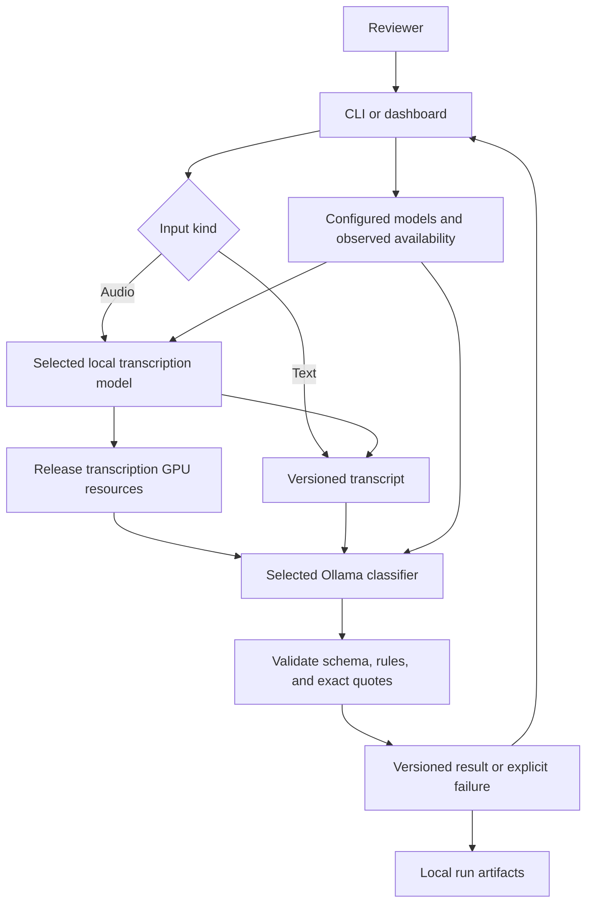

# F-004: Local model pipeline specification

Requirements: [feature requirements](01_REQUIREMENTS.md).
Status: batch 1 diagnostics implemented. Classification, evaluation, transcription, storage, and UI remain proposed.

## Current system and selected planning approach

The repo has standard-library Python preparation tools and frozen gold. It now has a Python diagnostics package and a read-only Ollama adapter, but no inference or UI. Batch 1 rechecked Ollama 0.40.14 responding locally with no installed models. Laptop details and external references are in [local model options](../../../docs/LOCAL_MODEL_OPTIONS.md).

Use one Python package and thin CLI and UI entrypoints. The proposed dashboard is Streamlit, which avoids a separate frontend and API for this local demo. Keep inference outside UI reruns and require explicit submit actions.

## Alternatives and rationale

| Design | Advantage | Cost | Recommendation |
| --- | --- | --- | --- |
| Python core, Ollama classifier, faster-whisper transcription, Streamlit dashboard | Reuses Python tooling, separates the two jobs, and supports a dedicated speech model. | Two inference runtimes and careful GPU release. | Proposed first build. |
| Gemma4 for both stages through Ollama | One runtime with text and audio capability. | Untested memory fit and transcription behavior on this laptop. | Keep as a later comparison; no automatic selection. |
| Separate web frontend and backend API | More UI flexibility and clearer future hosting options. | Additional tooling and deployment boundaries for a small local demo. | Defer until a concrete need appears. |

These alternatives were compared in this planning pass. No competing prototypes or full pstack architecture playbook ran.

## Module ownership and contracts

| Proposed path | Responsibility |
| --- | --- |
| pyproject.toml | Implemented package metadata and Python compatibility; optional audio and dashboard dependencies deferred until their owning batches. |
| config/models.json | Explicit local model entries, stage capabilities, runtime, and relevant settings; no selected classifier default. |
| src/voice_callback/domain.py | Transcript versions, model configurations, valid outcomes, run records, and explicit failure types. |
| src/voice_callback/models.py | Join configured capabilities with observed local availability; model discovery alone does not prove suitability. |
| src/voice_callback/ollama.py | Bounded requests to local Ollama, implemented health, discovery, and observed tag/digest identity; inference metadata verification and resource release remain later work. |
| src/voice_callback/classify.py | Build policy-grounded prompts and validate outcomes, rules, and exact transcript excerpts. |
| src/voice_callback/transcribe.py | Validate audio and invoke the explicitly selected, locally available faster-whisper model. |
| src/voice_callback/evaluate.py | Read isolated inputs, write predictions, then join expected answers in a separate scorer. |
| src/voice_callback/storage.py | Store local case versions and immutable run artifacts under ignored runtime directories. |
| src/voice_callback/cli.py | doctor, models, classify, evaluate, and transcribe entrypoints. |
| app.py | Dashboard forms, selectors, case view, errors, and separate reviewer decisions. |
| tests/test_models.py and tests/test_ollama.py | First-batch observable CLI and boundary behavior without model downloads. |

Keep existing scripts and frozen artifacts intact. Additional tests follow the behaviors in the requirements, with names recorded before each implementation slice.

Public operations are doctor(), list_models(stage), classify(transcript, model_config), transcribe(audio, model_config), and score(predictions, answers). Their concrete signatures are defined in batch 1. Business logic does not depend on Streamlit.

A transcript version carries case ID, version ID, exact text and hash, origin, and optional parent version. A model configuration carries stage, runtime, model ID, and explicit settings. An inference success contains validated output and provenance; a failure contains a typed cause and safe message. A missing result never carries a successful label.

Use a small result union rather than independent success flags and nullable labels. A callback output contains label, rule_ids, reason, and one or more verbatim evidence quotes. Schema and rule validation improve output integrity; semantic correctness is measured against reviewed examples.

## Proposed runtime flow

Text input can classify directly. Audio transcription and classification execute sequentially; a transcription failure stops the decision path. Run provenance includes both stages when audio is used.

## Interfaces and failure behavior

Use Ollama's local native HTTP API for health, discovery, and schema-constrained classification. Avoid an OpenAI or Anthropic API dependency and never provision credentials. Configure only loopback inference for this feature and reject cloud model entries. Do not silently truncate transcripts to fit a context window.

The prompt contains the accepted policy and clearly delimited transcript data. Transcript instructions do not change the rubric. Pin prompt and policy hashes per run. Resolve installed model identities using runtime metadata where available and record uncertainty if a revision cannot be resolved.

Use bounded connection and response timeouts. Surface configuration errors, unavailable models, inference timeouts, invalid output, audio decode failures, and GPU memory failures distinctly. No automatic retry may create duplicate successful run records. Runtime calls must not download missing model weights.

Start audio support with WAV, MP3, and FLAC, maximum 10 minutes and 50 MiB, as proposed demo limits. Verify actual decoding, duration, and size before inference. Keep temporary audio in the project runtime area and clean up only files created for that run. Establish the no-speech behavior on silent and short fictional fixtures before integration.

Proposed faster-whisper execution uses one file at a time, with a tested GPU compute mode. Check CUDA libraries explicitly. Select CPU or the smaller model explicitly if needed and record that choice; no invisible fallback. Unload the prior model and verify actual GPU memory recovery during integration.

Persist runtime data below ignored runtime/ and reports/ directories. Use unique run IDs and exclusive writes. Keep session edits from rerunning inference accidentally. Database migrations, multi-user authorization, generated web clients, and hosted jobs are not applicable to this local single-user design.

## Evaluation and verification

Develop only with the frozen development inputs and answers. Freeze model digest, prompt, policy, settings, and code revision before held-out inference. The inference reader accepts only the ID and transcript fields from input files. The scorer reads answers after predictions are stored.

Score failures separately and include them in overall coverage and strict callback recall denominators. Preserve predicted needs_review as a policy outcome. Store per-case disagreements, confusion counts, denominators, and failures. A 20-case held-out run is a small demonstration, not a production quality claim.

For paired audio, hold the classifier configuration constant across reference text and recognized text. Report transcription differences and decision changes separately. Measure complete transcription execution, including consuming generated segments, and distinguish model loading from warm inference.

Offline checks use controlled local HTTP responses and synthetic fixtures. Live checks prove local model identity, schema output, transcript evidence, resource handoff, and dashboard behavior. Exact commands and evidence belong in the [plan](03_IMPLEMENTATION_PLAN.md).

## Design changes

Batch 1 uses Python 3.10+ with no runtime dependencies and pins setuptools 80.9.0 for editable builds. Optional audio/UI dependency declarations are deferred until their owning batches verify versions, avoiding speculative dependencies or installation in batch 1.

Implemented signatures are doctor(client: OllamaClient) -> DoctorReport, load_registry(path: Path) -> tuple[ModelConfig, ...], and list_models(configs, installed, stage=None) -> tuple[ModelAvailability, ...]. A null installed inventory means unknown; an empty tuple means the server reported zero models. The CLI exposes doctor and models only. Later operation signatures remain proposed and have no placeholder implementations.

RunResult is RunSuccess | RunFailure. TranscriptVersion hashes exact UTF-8 text and records parent/origin. ModelConfig copies settings into a read-only mapping. RunProvenance records model configuration, digest uncertainty, runtime version, transcript identity/hash, prompt/policy versions and hashes, start time, and elapsed seconds. Stage adapters will create and validate actual results in later batches.

The shipped registry contains the planned faster-whisper turbo and small candidates with no selected classifier or defaults. Runtime availability for those candidates is unverified. Exact installed Ollama tags plus explicitly configured stage capability establish inventory compatibility, not semantic suitability or inference success. Remote metadata/cloud tags are excluded. Batch 2 must inspect selected model details before execution.

HTTP uses http.client directly, bypasses proxies, refuses redirects, caps responses at 1 MiB, and bounds connection and total request time. A deadline timer interrupts even a continuously slow response. Defaults are 1 second to connect and 3 seconds total per request. Only loopback URLs are accepted. No inference, pull, resource-release, cloud, or mutation endpoint is called by batch 1. See [local setup](../../../docs/LOCAL_SETUP.md) for supported states and exit codes.
