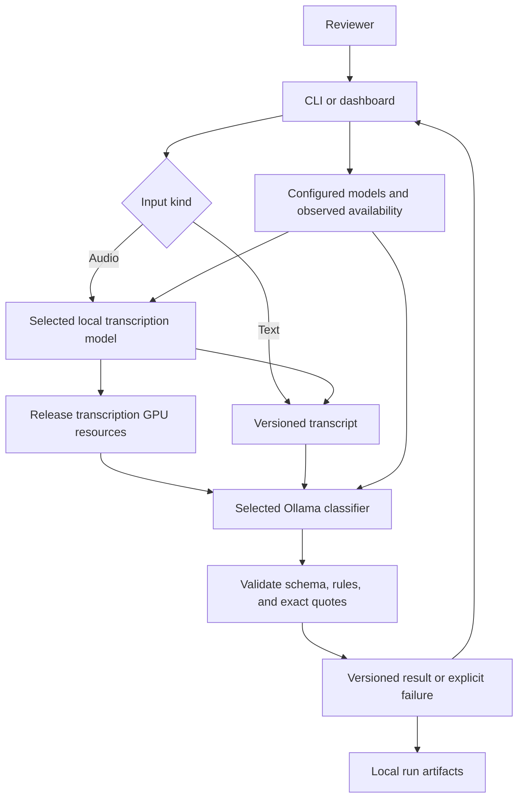

# F-004: Local model pipeline specification

Requirements: [feature requirements](01_REQUIREMENTS.md).
Status: batches 1 and 2 implement diagnostics, text classification, and exclusive local classification records. Batch 3 implements development evaluation and guarded held-out preparation. F-006 owns the proposed text frontend/API; transcription and paired-audio verification are the final stage.

## Current system and selected planning approach

The repo has standard-library Python preparation tools and frozen gold. It now has a Python diagnostics package, local text classifier, and CLI run records, plus evaluation commands, but no UI. Batch 1 rechecked Ollama 0.40.14 responding locally with no installed models. Laptop details and external references are in [local model options](../../../docs/LOCAL_MODEL_OPTIONS.md).

Use the existing Python core and thin CLI/API entrypoints. SRC-020 supersedes the prior Streamlit proposal: F-006 proposes a separate Next.js frontend and FastAPI API behind a single Nginx browser origin. Explicit submissions invoke inference; selector, editor and navigation changes never do. See [F-006 boundaries and contracts](../../completed/F-006-text-review-workspace/02_TECHNICAL_SPEC.md).

## Alternatives and rationale

| Design | Advantage | Cost | Recommendation |
| --- | --- | --- | --- |
| Python core and Streamlit dashboard (historical proposal) | Low initial setup. | Insufficient fit for the requested review workspace. | Rejected by owner under SRC-020. |
| Gemma4 for both stages through Ollama | One runtime with text and audio capability. | Untested memory fit and transcription behavior on this laptop. | Keep as a later comparison; no automatic selection. |
| Next.js frontend, thin FastAPI API, Nginx one-origin routing | Precise review/editor state and reusable Python core. | Separate web tooling and API job/persistence contracts. | Owner-approved direction under SRC-020; proposed implementation owned by F-006. |

These alternatives were compared in this planning pass. No competing prototypes or full pstack architecture playbook ran.

## Module ownership and contracts

| Proposed path | Responsibility |
| --- | --- |
| pyproject.toml | Implemented package metadata and Python compatibility; optional audio and dashboard dependencies deferred until their owning batches. |
| config/models.json | Explicit local model entries, stage capabilities, runtime, and relevant settings; no selected classifier default. |
| src/voice_callback/domain.py | Transcript versions, model configurations, valid outcomes, run records, and explicit failure types. |
| src/voice_callback/models.py | Join configured capabilities with observed local availability; model discovery alone does not prove suitability. |
| src/voice_callback/ollama.py | Bounded requests to local Ollama, implemented health, discovery, and observed tag/digest identity; inference metadata verification and resource release remain later work. |
| src/voice_callback/classify.py | Build policy-grounded prompts and validate outcomes, rules, and exact transcript excerpts. |
| src/voice_callback/transcribe.py | Validate audio and invoke the explicitly selected, locally available faster-whisper model. |
| src/voice_callback/evaluate.py | Read isolated inputs, write predictions, then join expected answers in a separate scorer. |
| src/voice_callback/storage.py | Store local case versions and immutable run artifacts under ignored runtime directories. |
| src/voice_callback/cli.py | doctor, models, classify, evaluate, and transcribe entrypoints. |
| F-006 web/ and API modules (proposed) | Text workspace, jobs, case/version/review persistence, Nginx routes; see F-006 specification. No app.py or Streamlit entrypoint is planned. |
| tests/test_models.py and tests/test_ollama.py | First-batch observable CLI and boundary behavior without model downloads. |

Keep existing scripts and frozen artifacts intact. Additional tests follow the behaviors in the requirements, with names recorded before each implementation slice.

Public operations are doctor(), list_models(stage), classify(transcript, model_config), transcribe(audio, model_config), and score(predictions, answers). Their concrete signatures are defined in batch 1. Business logic does not depend on the frontend or FastAPI. They reuse the existing contracts and core operations.

A transcript version carries case ID, version ID, exact text and hash, origin, and optional parent version. A model configuration carries stage, runtime, model ID, and explicit settings. An inference success contains validated output and provenance; a failure contains a typed cause and safe message. A missing result never carries a successful label.

Use a small result union rather than independent success flags and nullable labels. A callback output contains label, rule_ids, reason, and one or more verbatim evidence quotes. Schema and rule validation improve output integrity; semantic correctness is measured against reviewed examples.

## Proposed runtime flow

Text input can classify directly. Audio transcription and classification execute sequentially; a transcription failure stops the decision path. Run provenance includes both stages when audio is used.

## Interfaces and failure behavior

Use Ollama's local native HTTP API for health, discovery, and schema-constrained classification. Avoid an OpenAI or Anthropic API dependency and never provision credentials. Configure only loopback inference for this feature and reject cloud model entries. Do not silently truncate transcripts to fit a context window.

The prompt contains the accepted policy and clearly delimited transcript data. Transcript instructions do not change the rubric. Pin prompt and policy hashes per run. Resolve installed model identities using runtime metadata where available and record uncertainty if a revision cannot be resolved.

Use bounded connection and response timeouts. Surface configuration errors, unavailable models, inference timeouts, invalid output, audio decode failures, and GPU memory failures distinctly. No automatic retry may create duplicate successful run records. Runtime calls must not download missing model weights.

Start audio support with WAV, MP3, and FLAC, maximum 10 minutes and 50 MiB, as proposed demo limits. Verify actual decoding, duration, and size before inference. Keep temporary audio in the project runtime area and clean up only files created for that run. Establish the no-speech behavior on silent and short fictional fixtures before integration.

Proposed faster-whisper execution uses one file at a time, with a tested GPU compute mode. Check CUDA libraries explicitly. Select CPU or the smaller model explicitly if needed and record that choice; no invisible fallback. Unload the prior model and verify actual GPU memory recovery during integration.

Persist runtime data below ignored runtime/ and reports/ directories. Use unique run IDs and exclusive writes. Keep session edits from rerunning inference accidentally. F-006 separately proposes local case/version/review persistence and single-job API admission; no hosted job infrastructure or multi-user system is planned.

## Evaluation and verification

Develop only with the frozen development inputs and answers. Freeze model digest, prompt, policy, settings, and code revision before held-out inference. The inference reader accepts only the ID and transcript fields from input files. The scorer reads answers after predictions are stored.

Score failures separately and include them in overall coverage and strict callback recall denominators. Preserve predicted needs_review as a policy outcome. Store per-case disagreements, confusion counts, denominators, and failures. A 20-case held-out run is a small demonstration, not a production quality claim.

For paired audio, hold the classifier configuration constant across reference text and recognized text. Report transcription differences and decision changes separately. Measure complete transcription execution, including consuming generated segments, and distinguish model loading from warm inference.

Offline checks use controlled local HTTP responses and synthetic fixtures. Live checks prove local model identity, schema output, transcript evidence, resource handoff, and dashboard behavior. Exact commands and evidence belong in the [plan](03_IMPLEMENTATION_PLAN.md).

## Design changes

The approved batch 3 contract migration supersedes the stdlib-only bootstrap for external validation. contracts.py owns strict Pydantic registry/settings, transcript input, CallbackOutput, and discriminated saved success/failure records; evaluation_contracts.py owns evaluation configuration, lifecycle markers, reports, and frozen-system envelopes. Configuration uses strict=True, extra=forbid, finite numbers, and frozen model fields. Internal domain/scoring dataclasses remain useful immutable values. Tuple fields preserve order; Python whitespace checks and semantic validators preserve earlier behavior without normalizing text.

The bounded json_io decoder remains first so duplicate keys, non-finite numbers, excessive nesting, blank JSONL records, and Unicode separators retain their established behavior. JSON-mode validation accepts JSON arrays and enum strings while refusing scalar coercion. CallbackOutput.model_json_schema supplies both the Ollama format and the schema embedded in the prompt; application validators retain unique rules/evidence, outcome-rule consistency, and exact transcript quotes. The schema change advances the prompt to callback-text-v2. System configuration records callback-contract-v1 plus Pydantic/core versions, which participate in freeze compatibility.

Pydantic 2.14.3 and its full runtime closure are hash-pinned in requirements-runtime.txt, independently of development tools. CI explicitly installs both locks. A prepared wheel cache supports offline, hash-verified clean-wheel installation and snapshot checks. Preserve the original callback-text-v1 development artifacts. New source fingerprints and a fresh clean-commit development baseline are required before final configuration freeze; do not rewrite prior reports or imply that validation guarantees semantic correctness or deterministic inference.

The implementation follows the official [strict-mode](https://docs.pydantic.dev/latest/concepts/strict_mode/) and [schema-generation](https://docs.pydantic.dev/latest/concepts/json_schema/) contracts and Ollama's [Pydantic structured-output example](https://docs.ollama.com/capabilities/structured-outputs). Migration regressions verify the required behavior locally, including Python whitespace semantics that differ from the regex engine.

Batch 1 uses Python 3.10+ with no runtime dependencies and pins setuptools 80.9.0 for editable builds. Optional audio/UI dependency declarations are deferred until their owning batches verify versions, avoiding speculative dependencies or installation in batch 1.

Implemented signatures are doctor(client: OllamaClient) -> DoctorReport, load_registry(path: Path) -> tuple[ModelConfig, ...], and list_models(configs, installed, stage=None) -> tuple[ModelAvailability, ...]. A null installed inventory means unknown; an empty tuple means the server reported zero models. The CLI exposes doctor, models, classify, evaluate, score, and freeze-evaluation. Transcription remains proposed without a placeholder implementation.

RunResult is RunSuccess | RunFailure. TranscriptVersion hashes exact UTF-8 text and records parent/origin. ModelConfig copies settings into a read-only mapping. RunProvenance records model configuration, digest uncertainty, runtime version, transcript identity/hash, prompt/policy versions and hashes, start time, and elapsed seconds. The classifier now creates actual validated RunSuccess or RunFailure records; transcription remains a later adapter.

The shipped registry contains the owner-selected qwen3.5:4b-q4_K_M classifier and planned faster-whisper turbo and small candidates. Every classify command requires an explicit configuration ID; no default is inferred. Runtime availability for those candidates is unverified. Exact installed Ollama tags plus explicitly configured stage capability establish inventory compatibility, not semantic suitability or inference success. Remote metadata/cloud tags are excluded. Batch 2 inspects local completion, thinking, format, and context metadata before execution and checks that the installed digest remains stable.

HTTP uses http.client directly, bypasses proxies, refuses redirects, caps responses at 1 MiB, and bounds connection and total request time. A deadline timer interrupts even a continuously slow response. Defaults are 1 second to connect and 3 seconds total per request. Only loopback URLs are accepted. No inference, pull, resource-release, cloud, or mutation endpoint is called by batch 1. See [local setup](../../../docs/LOCAL_SETUP.md) for supported states and exit codes.

### Batch 2 implementation decisions

SRC-018 selects qwen3.5:4b-q4_K_M. classify(transcript, model, client, policy_path=...) returns RunSuccess | RunFailure. load_transcript accepts UTF-8 .txt and input-only .jsonl, preserving text exactly. No implicit model is selected. Policy v1.0 is pinned to its accepted byte hash, and the prompt includes that policy plus a JSON response schema. No candidate or gold answer file is read by classification.

The application caps transcript text at 12000 UTF-8 bytes and the input file at 1 MiB. These are explicit demo limits, not token estimates. Ollama 0.40.15 or later is required for the inspected truncate/shift contract. Requests send truncate false and shift false so the runtime rejects actual token overflow rather than discarding context. The initial model configuration uses num_ctx 8192, num_predict 768, temperature 0, seed 42, think false, and keep_alive 0. These development settings establish no quality threshold. Output ending because of the token limit is a processing failure.

Inference uses a separate 180-second total deadline, configurable up to 600 seconds; health and metadata retain the shorter diagnostic limits. Responses require completed assistant output from the exact tag. Validation rejects extra or duplicate fields, invalid labels, unknown or outcome-inconsistent rules, empty or oversized reasons/evidence, and quotes absent from the exact transcript. It validates structure and support locations, not semantic truth of every claim in the reason.

Provenance adds case ID, loopback URL, model-metadata hash, and request hash to the existing versions, model digest, settings, hashes, UTC start, and elapsed time. storage.py was pulled forward from later storage work to retain individual classification successes and failures in exclusive runtime/classifications files. Evaluation reports, case management, and reviewer decisions remain later work. A filesystem error is reported separately from a policy outcome. No retries, pull endpoint, or cloud fallback exists in the application.

### Batch 3 implementation decisions

The evaluator reuses the classifier and its actual request hashes. json_io.py centralizes bounded strict JSON and LF-only JSONL parsing; datasets.py validates frozen manifest hashes and split coverage with separate input and answer reads. scoring.py owns Prediction, ReferenceAnswer, and pure score(predictions, answers) with explicit denominators. evaluation_config.py owns system/source identity and frozen-configuration compatibility. evaluate.py owns exclusive artifact directories, interruption/completion state, persisted predictions, deterministic offline scoring, and freeze preparation. CLI adapters invoke those operations without business logic.

Each report requires exactly one success or processing failure per frozen input. The three-by-three outcome matrix excludes processing failures while a separate expected-label failure count preserves its denominators. Undefined ratios are null. Per-case disagreements retain expected labels and rationales only in scoring artifacts. No answer fields are passed to classify. A source/data/model/prompt/policy/runtime/settings mismatch blocks reuse; no automatic model download or retry is added.

Development evaluation is authorized for this batch. Real held-out inference remains unperformed until explicit owner authorization with a frozen configuration. Freezing verifies completed clean-source development evidence and records the current clean revision; it is not semantic-quality acceptance. Source fingerprints cover package Python bytes; Git revision and clean state remain separate provenance. Reports and freezes are ignored local artifacts, while their commands and observed evidence belong in this plan.
