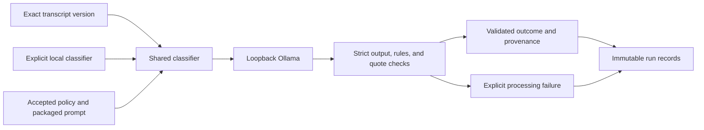
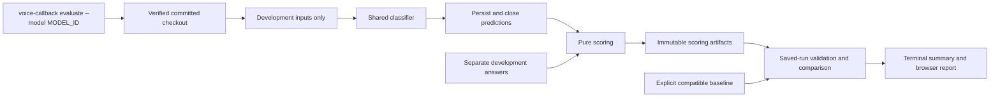

# F-004: Local model pipeline specification

Requirements: [feature requirements](01_REQUIREMENTS.md).
Status: completed for the retained text scope after owner testing and QA acceptance, SRC-026, 2026-11-08. The [implementation plan](03_IMPLEMENTATION_PLAN.md) preserves dated design and execution history. Audio is deferred to the [roadmap](../../../docs/ROADMAP.md).

## Current ownership

The Python core provides local diagnostics, explicit model selection, text classification, strict contracts, immutable run records, evaluation, offline scoring, and guarded configuration freezing. F-006 implements the Next.js Review desk, FastAPI/SQLite workspace, and loopback Nginx routing. F-011 adds the coherent evaluation command, readable reports, and saved development baseline comparison.

| Path or feature | Responsibility |
| --- | --- |
| `config/models.json` and `models.py` | Explicit configured capabilities joined to observed local availability. No implicit classifier selection or automatic model download. |
| `domain.py`, `contracts.py`, `evaluation_contracts.py` | Internal values and strict external registry, response, run, and evaluation contracts. |
| `ollama.py` | Bounded loopback diagnostics, metadata checks, classification requests, runtime/model identity, and requested resource release. |
| `classify.py` and `prompts/` | Versioned policy-grounded instructions, structured output validation, rule checks, and exact transcript evidence. |
| `storage.py` | Exclusive individual classification records under ignored runtime directories. |
| `datasets.py` and `json_io.py` | Frozen split/hash validation and bounded strict JSON with LF-only JSONL records. |
| `evaluate.py`, `scoring.py`, `evaluation_config.py` | Inference artifacts, completion state, pure scoring, source/system identity, and freeze compatibility. |
| F-011 evaluation modules | Committed-checkout execution, optional environment/tracing, saved-run review, baseline comparison, and escaped standalone HTML. See [F-011 specification](../../completed/F-011-evaluation-workflow/02_TECHNICAL_SPEC.md). |
| `cli.py` | `doctor`, `models`, `classify`, `evaluate`, `evaluations`, `score`, and `freeze-evaluation` adapters. |
| F-006 `web/` and API modules | Explicit submissions, transcript versions, jobs, run history, and separate human decisions. See [F-006 specification](../../completed/F-006-text-review-workspace/02_TECHNICAL_SPEC.md). |

Business logic does not depend on the frontend or FastAPI. No transcription adapter or command is implemented. Registry entries for future transcription candidates do not establish runtime support.

## Text classification

The owner-selected classifier is `qwen35-4b`, with Ollama tag `qwen3.5:4b-q4_K_M`. Classification accepts exact UTF-8 text or input-only JSONL. It pins accepted policy v1.0 and the packaged `callback-text-v2` prompt. Gold answers never enter classification requests.

Transcript versions retain case/version IDs, exact text/hash, origin, and optional parent. Success and failure are separate result variants. Valid outcomes are `callback_required`, `no_callback`, and `needs_review`. A timeout or malformed response never becomes a policy outcome.

Strict Pydantic models reject extra fields and scalar coercion. Bounded JSON decoding rejects duplicate keys and non-finite values. Validators preserve Unicode and exact text, check outcome-consistent policy rules, and require verbatim evidence quotes. These checks establish structure and support locations; they do not prove semantic correctness.

The implemented limits are 12000 transcript UTF-8 bytes and a 1 MiB input file. Classification requires Ollama 0.40.15 or later for the inspected overflow contract. Requests disable truncation and shifting. Initial settings are `num_ctx=8192`, `num_predict=768`, `temperature=0`, `seed=42`, `think=false`, and `keep_alive=0`. Token exhaustion is a processing failure.

Inference has a 180-second total deadline, configurable up to 600 seconds. Diagnostics use shorter deadlines. HTTP bypasses proxies, refuses redirects, caps response sizes, and accepts loopback URLs only. No automatic retries, model pulls, or cloud fallback exist.

Provenance records model tag/digest and metadata hash, runtime version and URL, settings, prompt and policy versions/hashes, request hash, transcript identity/hash, UTC start, elapsed time, and success/failure status. Earlier runs remain bound to their original transcript versions.

## Evaluation and evidence boundaries

Every frozen input produces exactly one success or processing failure. Predictions close before the scorer opens answers. The three-outcome confusion matrix covers valid outputs; processing failures remain explicit in coverage and recall denominators. Undefined metrics retain null values and their denominators.

F-011 executes evaluation, score, and freeze operations from committed source bytes. This avoids Windows checkout line endings changing source identity. Existing fingerprints remain strict. Saved-snapshot review validates artifact bindings and scorer counts without rerunning historical source. Comparison permits model/prompt/code changes while requiring matching data, cases, and metric definitions.

Model settings stay in `config/models.json`. Optional tracing uses allowlisted root `.env` values with process and CLI overrides for development. Credentials remain outside artifacts. No YAML profile is required. See the [evaluation guide](../../../docs/EVALUATION.md) for commands and recovery.

Held-out execution requires a matching frozen configuration and explicit opt-in. The guarded path is implemented and verified with synthetic tests. SRC-026 closes text delivery after owner testing and QA, while transferring actual candidate freeze, real held-out measurement, and numeric production-quality targets to [quality follow-up](../../../docs/ROADMAP.md#model-quality-and-release-follow-up). No real held-out result or production-quality threshold is claimed.

## Design history

The initial Streamlit proposal was rejected under SRC-020 in favor of the implemented Next.js/FastAPI/Nginx workspace. Early two-stage audio and Gemma proposals were unverified alternatives. SRC-018 selected Qwen for text; SRC-024 deferred audio. The [dated execution record](03_IMPLEMENTATION_PLAN.md) preserves the original decisions, commands, and verification limits.
