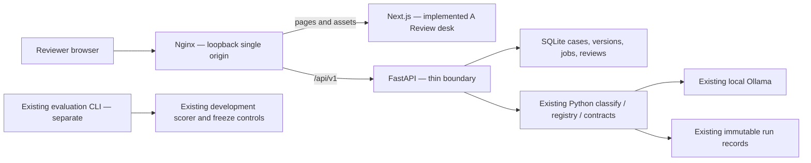

# F-006: Text review workspace specification

Status: selected A implemented in Next.js with FastAPI/SQLite and loopback Nginx. Production-stack browser verification uses a controlled Ollama HTTP fixture; live model quality and deployment are excluded. [Requirements](01_REQUIREMENTS.md) own acceptance.

## Boundaries

Next.js owns editor drafts, selected case/run/model, rendering and polling. It does not validate policy or build inference prompts. FastAPI parses strict request envelopes, binds immutable IDs, performs availability/admission checks, writes job metadata, and invokes the existing core outside the request event loop. The core owns the authoritative CallbackOutput Pydantic schema, policy consistency, verbatim quotes, model metadata and run provenance. Keep a single classifier and scorer.

Implemented paths: web/ for Next.js; src/voice_callback/api.py for routing and response/error translation; workspace.py for case/version/review operations; jobs.py for single-job admission, execution and recovery; admission.py for shared CLI/API ownership; config/nginx.conf for routing. All these paths are implemented. Add focused modules only when responsibility requires them. No Redis, Celery, message broker, hosted queue or new database service.

## Historical API contract draft v1

All paths below are under /api/v1. The implementation update below owns current payload/pagination differences from this initial contract draft. JSON is UTF-8, strict shape/extra-field rejection. Opaque IDs are issued by Python; never accept arbitrary paths or model URLs. Dates are UTC ISO-8601. IDs and hashes identify exact immutable records. The app uses development inputs only; these routes do not expose evaluation answers or freeze/held-out execution.

| Method / path | Request | Response / action |
| --- | --- | --- |
| GET /runtime | None | Health plus configured model IDs, tag, observed availability and reason; distinguish unknown inventory from empty. No inference. |
| GET /development-cases | None | Bounded input-only IDs/titles; no answers or held-out IDs. Explicit load creates a local workspace copy. |
| POST /cases | {transcript_text, origin: pasted} or {development_case_id} | 201 case_id, transcript_version_id, exact UTF-8 hash; reject mixed input variants. |
| GET /cases?outcome=&review=&cursor=&limit= | Optional latest-run outcome and latest-review filters; limit 1–50 | Summary page, next cursor. Processing failures are their own status, not needs_review. |
| GET /cases/{id} | None | Version summaries and latest run/review IDs; fetch text/run detail separately. |
| POST /cases/{id}/versions | {parent_version_id, text}; If-Match current version | 201 immutable version with parent/hash. 409 stale parent; drafts never overwrite. Identical text may return existing version without mutation. |
| GET /cases/{id}/versions/{version} | None | Exact text, origin, parent, hash, created_at. |
| POST /jobs | {case_id, transcript_version_id, model_config_id}; Idempotency-Key required | 202 job_id, status: running, submitted version/model snapshot and poll URL. 409 busy if a different job holds admission. |
| GET /jobs/{id} | None | running {started_at, deadline_at} or succeeded {run_id} or failed {run_id, error}. Discriminated union; a failure cannot include an outcome. |
| GET /cases/{id}/runs?cursor=&limit= | limit 1–50 | Immutable summaries for this case, including failures and transcript/model version. |
| GET /runs/{id} | None | Validated core run plus case/version reference, provenance, review events. Successful output reuses CallbackOutput; failure reuses safe error semantics. |
| POST /runs/{id}/reviews | {decision, note}; Idempotency-Key required | 201 append-only human review event, run/version reference, local reviewer identity, timestamp. Only successful named runs accepted. |

Example submit: {"case_id":"local-101","transcript_version_id":"tv-2","model_config_id":"qwen35-4b"}. Client cannot supply a gold label, prompt, runtime address or raw settings. Server snapshots the approved registry config and verifies installed identity before execution. Review decision is one of the three policy labels; note max 2,000 UTF-8 bytes. No public authentication/multi-user assertion is implied by a local reviewer identity.

Return a bounded safe envelope for request failures: {"error":{"code":"job_busy","message":"Another inference job is active.","retryable":true,"job_id":"job-123"}}. Request ID is server-generated for diagnostics. Never include raw provider bodies, filesystem paths, stack traces or transcript content in an error. Field names and safe limit values are allowed. Runtime failure detail lives on the immutable failed run, not as a fabricated recommendation.

400 invalid_request / mismatched idempotency key payload; 404 unknown resource; 409 job_busy, stale_version or conflicting reuse; 413 payload_too_large; 422 empty/invalid transcript, wrong model stage or failed validation; 503 runtime_unavailable or recovery_required. Accepted jobs finish with typed failures such as inference_timeout, invalid_output, context_limit, resource_exhausted, runtime_unavailable or interrupted. Existing core failure codes must be mapped explicitly in implementation tests. Model needs_review is a successful policy outcome, distinct from any failure.

## Long-running work and admission

POST returns after durable admission; inference runs in one bounded background executor. The API process is a single local worker, with an OS-held exclusive workspace admission lock and exclusive artifact creation. A lost HTTP response is reconciled by retrying the same idempotency key; the server returns the original job for the same payload, never reruns it. A different payload/key can start only when admission is free. Do not automatically queue. Browser disables submit while active, but server admission is authoritative.

Core defaults to a 180-second inference deadline, configurable up to 600 seconds; the initial API reuses 180 seconds and retains the core's separate short diagnostic/metadata limits. API does not invent a short synchronous request around it. Poll every 1.5 seconds; pause polling in hidden tabs and reconnect by job ID. No percentage or completion estimate without runtime evidence. Refresh and navigation restore a saved job ID without submitting. A browser abort stops polling only. First release offers no cancellation guarantee. A timeout becomes a failed run only after the core returns/its socket is closed; do not release admission while work might still execute.

At startup, unfinished metadata becomes interrupted, preserving artifacts. Process loss may leave Ollama work briefly active: mark admission recovery_required and check actual runtime quiescence or require explicit local recovery before new work. Never infer quiescence from an expired timestamp alone. The same admission guard must cover CLI classification/evaluation and API inference to preserve the one-job invariant across entrypoints; migration of those callers and contention tests belong to the API batch. A process-local boolean is insufficient. Existing historical CLI behavior is not retroactively claimed to enforce this guard.

## Local persistence and resource limits

The initial design proposed JSON files; the implemented backend uses runtime/workspace/workspace.sqlite3, schema version 1. Transactions couple case/version saves, idempotency/resource bindings and run/terminal-job publication. SQLite triggers forbid mutation/deletion of version, run and review history and edits to terminal jobs. No database service is added. Core run artifacts retain their authoritative strict JSON format inside immutable database records; existing CLI files remain unchanged. Atomic publish of small metadata, exclusive files and the one writer prevent partial reads; no overwriting of versions/results/reviews. Recover interrupted jobs without declaring success. Indexes are rebuildable from records; use bounded list pagination instead of loading all text. Check disk errors before accepting work; a failed write cannot report a saved review or completed job. Retain history until a later explicit retention decision; no automatic deletion in this scope.

Transcript limit remains 12,000 UTF-8 bytes; proposed HTTP request cap is 64 KiB at Nginx and Python, with Python's exact per-field checks authoritative. Input is never silently truncated; byte count differs from characters/tokens. JSON response caps and runtime limits reuse the core's bounded adapter (1 MiB response; context 8192, output 768). Lists return at most 50 summaries, notes at most 2,000 bytes, one active inference and no queue. Local storage capacity is not promised unlimited: report storage_unavailable and preserve prior records. Final audio limits are F-004's separate proposal, not accepted text API formats.

Bind Nginx to loopback by default; Next.js, FastAPI and Ollama remain loopback services. Proxy /api/v1 unchanged to Python; all other pages/assets go to Next.js. Browser only calls relative /api URLs. Request polling endpoints stay short; no streaming dependency. Reject foreign Origin on writes, disallow permissive CORS, accept application/json only, and use a same-origin session nonce for mutations to resist cross-site local requests. Validate Host against configured loopback origins. These are proposed local boundaries, not production security acceptance. Hosted access/authentication is outside scope.

## Interaction and evidence

The chosen run dictates the transcript view and highlights; an editor draft is visibly separate. Saving edits creates a child version and leaves the old run selected with a newer-text notice. Classify names the saved version it will submit. Match validated quote strings against exact text; highlight all exact occurrences, with accessible text naming the supporting quote. Never normalize transcript text to make evidence fit. Reveal all evidence quotes when there are several. A prior failure has no highlights or output label. Human review always identifies the selected run/version and appends an event; future corrections do not replace earlier events.

Desktop A: case rail, transcript left, recommendation and human decision right, history underneath. Desktop B: horizontal cases, recommendation/review band, full-width transcript, then history. At 390px use sequential sections and horizontal case navigation; no inference-critical sticky bar obscures text. Existing labels carry outcome color semantics; focus and errors also use words. Prototype controls are separate and clearly simulated.

## Verification boundary

Static prototype interaction checks prove only browser simulation behavior. API contract/worker/restart/admission tests, real Nginx routing, production Next.js browser flows, runtime failure integration and accessibility checks supply AC02–AC10 evidence. Live development inference requires its own authorized implementation batch and honest provenance; this design runs no inference, downloads or held-out evaluation.

## Implemented backend contract, 2026-11-07

The generated [OpenAPI schema](../../../docs/api/openapi.json) records request and typed response schemas from actual routes. Run scripts/export_workspace_openapi.py to regenerate, or --check to detect drift. Composite/detail responses are typed. web/lib/api.generated.ts is generated from this schema; web/lib/api.ts validates unknown JSON with Ajv before exposing those types to the UI.

- POST /cases takes {text, title?}, returning {case, version}; origin is server-owned. POST /cases/{id}/versions takes {text, parent_version_id}; the parent ID supplies the transactional compare-and-save guard, replacing redundant If-Match planning. No input normalization occurs. Identical text returns its existing version.
- GET /development-cases lists three newly authored input-only fictional cases, separate from frozen data. POST /development-cases/{id}/load with {} creates a workspace copy with development_case_id provenance. It never invokes inference or loads expected answers/held-out files.
- GET /cases accepts outcome, review=reviewed|pending, status=running|succeeded|failed|interrupted, offset>=0 and limit=1..50. Filters apply before pagination to the latest job and its latest review. Offset pagination is the initial bounded local implementation; cursor pagination is deferred.
- GET /cases/{id} returns the case, at most 50 recent version summaries (without text), and at most 50 recent jobs. GET /cases/{id}/versions/{version} retrieves exact text. GET /cases/{id}/runs lists at most 50 job/run-ID summaries with offset/limit; GET /runs/{run} retrieves the strict saved run.
- POST /jobs requires Idempotency-Key and the submitted version/model IDs. Response/poll records contain status, created_at, terminal finished_at/run_id/error where available, model/settings and source identity. No estimated deadline/progress is invented. A failed core run is linked via run_id; an interrupted worker has error=recovery_required and no successful outcome. Repeated key/payload returns its original job; changed payload conflicts.
- POST /runs/{run}/reviews appends an idempotent event, never updates output. GET /cases/{id}/reviews exposes bounded review-event history with offset/limit. Reviewer identity is local_owner, without a multi-user authentication claim.
- GET /session supplies an in-memory startup nonce. Mutations require the matching X-Workspace-Nonce, application/json, and a matching allowed Host/Origin. Current allowed browser origins are http://127.0.0.1:8000 and http://127.0.0.1:8080. No permissive CORS; Next.js uses the single Nginx origin through relative /api paths. Foreign origins, malformed/non-ASCII nonce, duplicate JSON keys, over-limit bodies and invalid fields return bounded safe errors without echoing input. HTTP 415 distinguishes wrong content type; current error envelopes contain code/message, without fabricated retryability metadata.
- GET /runtime delegates read-only diagnostics and reports availability separately from inference. The API returns 202 for admitted jobs; a missing runtime/model becomes a preserved core processing failure. A disabled frontend action will use diagnostics, but server validation stays authoritative.

The single background worker is outside the request event loop. CLI classify/evaluate and API jobs use the same runtime/inference lock directory by default; custom directories must be shared consistently. A persistent marker remains after unknown worker failure or process interruption. Startup reconciles unfinished database jobs only while holding free OS ownership, regardless of whether an operator recovered the marker first. It never interrupts a live lock owner. Explicit recover-inference --runtime-stopped only clears admission after the operator confirms runtime stop/restart; no timestamp or /api/ps guess is treated as proof of quiescence. Library callers of raw classify/evaluate must supply admission ownership; the CLI/API entrypoints do so.

Next.js, Nginx and end-to-end browser behavior have controlled functional evidence. Live model quality remains unverified in this feature. See the implementation plan for exact acceptance and package evidence.

### Uncertain transport completion

A timeout, unavailable connection, HTTP transport error or invalid transport response can leave provider execution uncertain. The saved failed job/run remains inspectable, but admission retains its recovery marker and the job reports recovery_required. The CLI classification path does the same. Evaluation preserves the failed prediction and aborted artifacts, opens no answers and sends no next case. Confirm a stopped/restarted runtime and explicitly recover before another submission; elapsed time or a closed client socket is not proof of provider quiescence.

## Implemented browser contract

GET /jobs returns bounded global job metadata so another tab can observe busy work. GET /submissions/{key} looks up an accepted job without retrying inference; response-loss reconciliation uses this endpoint before an explicit same-key retry. GET /runs/{id}/reviews pages review events for the selected run independently of the case's newest events. All lists use offset/limit (maximum 50). Runtime diagnostics expose ready/busy/recovery_required admission and live/controlled verification mode; mode is server configuration, not a browser toggle.

The client persists selected IDs/model, draft text and pending idempotency keys locally; SQLite is authoritative for saved history. Every response is schema-validated at its fetch boundary. No automatic mutation retry exists. Reconnect resets the session nonce and checks accepted submissions. Global polling pauses while hidden and never submits. A completed job updates its view and clears the processing notice. Input limits count UTF-8 bytes before saving and remain enforced in Python. The transcript editor receives keyboard focus; saving focuses its heading. Long lines wrap without changing exact saved text. Controlled fixtures are visibly labeled, and normal startup uses the configured local Ollama.

Nginx binds 127.0.0.1:8080, routes pages/assets to 127.0.0.1:3000 and /api unchanged to 127.0.0.1:8000, caps requests at 64 KiB and disables API caching. The launcher uses the production build, validates Nginx configuration and owns its child processes. Development/test tooling provisions dependencies only through explicit commands. SQLite schema version 1 creates new local storage; there is no migration of frozen data or CLI artifacts.

### Deferred startup recovery

If a healthy CLI/API owner holds admission at startup, reconciliation stays pending rather than interrupting that owner. The service retries when exclusive OS ownership becomes free. API route dependencies cover reads/polls, and submissions reconcile before idempotent replay or new admission. This prevents an earlier crashed job remaining running forever when startup occurs during CLI work. No timestamp replaces ownership proof.
