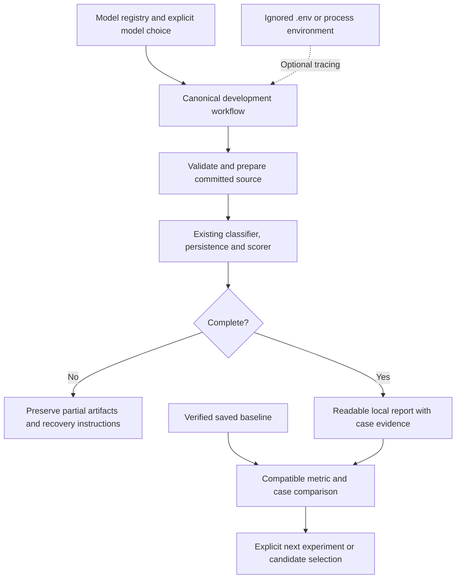

# F-011: Technical specification

Requirements: [feature requirements](01_REQUIREMENTS.md).

## Existing system and design constraints

`evaluate.py` owns persisted input-only inference, completion markers, auto scoring,
and candidate freezing. `scoring.py` owns pure metric definitions. The existing
classifier is shared by evaluation, CLI and the review desk. F-004's recorded
design intentionally opens answers only after predictions are complete.

The starting uncommitted F-009 launcher prepared a clean detached checkout and
required Langfuse. Its preparation behavior now belongs to the packaged workflow;
the existing script is a thin compatibility entry point requiring explicit --model.

`score_run()` requires the original package source fingerprint. Saved-baseline
inspection must remain separate from rescoring: compare immutable saved reports
after artifact validation, without rewriting them or claiming a historical rescore.
Compatibility requires equal split, dataset version/manifest/input/answer hashes,
scorer version and definitions. Model, prompt, settings and source may differ.

## Selected ownership and flow

One packaged operation owns preparation and execution. A separate read-only report
capability owns inspection, comparison and rendering, with no model or telemetry
side effects. Environment loading is a boundary function that recognizes only
supported keys. It does not persist or display secrets. No dependency or YAML file
is needed for the bounded configuration format.

## Alternatives and rationale

Two independent architect-style sketches were read in full and compared against
five criteria: one engine/writer, simple caller usage, reproducible source identity,
comparison across code changes, and incremental verification. Both converged on a
package-owned committed-checkout operation plus read-only review. Candidate B's
function-based operation is the base: it hides the same preparation/execution
complexity without Candidate A's stateful session wrapper. Candidate A contributed
explicit environment precedence and additive derived-report behavior. No model from
pstack's default cross-family pool was available; root synthesized without a judge.
This is an adapted architect sketch step, not a full architect/arena execution.

The competing larger shape was a database-backed app evaluation subsystem with
new API jobs and frontend navigation. It lost this first slice because immutable
per-run directories already own the lifecycle; adding another state writer would
increase coordination before report review was usable. A script-only facade also
lost because it would leave setup policy outside the packaged operation.

Caller usage is `evaluate --model MODEL_ID [--baseline RUN] [--trace]`, followed by
`evaluations [--run-dir RUN]` for offline history/review. Source-compatible `score`
and explicit `freeze-evaluation` remain separate lifecycle actions.

| Module | Owned interfaces and knowledge |
| --- | --- |
| evaluation_workflow.py | `EvaluationRequest`, `run_evaluation(request)`, `ArtifactRequest`, `run_artifact(request)`, private verified-checkout and worker command construction. |
| evaluation_environment.py | `evaluation_environment(root, tracing, metadata_only)` returns subprocess settings with allowlisted local defaults. |
| evaluation_worker.py | Private prepared-source process boundary; rejects parent-only options and requires explicit frozen/held-out authorization. |
| evaluate.py | Sole inference/artifact writer; `EvaluationProgress` reports starting, persisted cases, scoring, completion and incomplete location. |
| evaluation_review.py | `SavedEvaluation`, `load_review`, `assert_baseline_compatible`, `compare_reviews`, `summary_text`, additive `render_review`. |
| evaluation_report.py | Escaped standalone human report from one validated read model, including light/dark and narrow rendering. |

We accept one private process boundary to execute committed bytes. CLI preparation
refuses relevant source/input drift, confirms tracked input paths, verifies the
checkout's revision/common Git directory/clean state, and points worker imports at
its source. The worker writes reports and uses admission in the caller's explicit
absolute directories. The shared lease remains authoritative; a parent readiness
check rejects busy/recovery states early without reserving the worker's lease.

Reports validate saved v1 count consistency against the pure versioned scorer,
while clearly stating that historical source was not rerun. They preserve all source
report bytes. New template projections use a content-qualified path if an earlier
HTML differs. No mutable global latest-run catalog is introduced.

## Failure behavior and verification

Keep inference admission, timeout recovery, output validation and exclusive artifact
writes authoritative in the existing engine. Progress must not expose answers.
Reports render transcript/evidence as escaped text and load no third-party assets.
Baseline loading is read-only, checks completion and identities, and permits old
source only for inspection. Existing `score` retains its stricter source requirement.
No database or public HTTP schema migration is planned for the CLI/report slice.

Synthetic two-case runs and controlled transport verify results, comparison,
interruption, configuration precedence and source drift. They do not measure model
quality. Exact commands and evidence belong in the [plan](03_IMPLEMENTATION_PLAN.md).

## Design changes

The independently reproduced worker --prepare-only issue is fixed by rejecting parent-only flags before worker execution. Browser review identified mobile table wrapping; the renderer uses internal table scrolling. These refinements preserve the selected boundaries.

## Review corrections: consistent source context and offline status

Canonical `score` and `freeze-evaluation` now use the same current committed
checkout selection as `evaluate`. The private worker calls the existing core
operations directly. It never recursively invokes the parent launcher. Windows
CRLF workspace bytes therefore do not differ from the LF source actually measured
by evaluation when the artifact is rescored or frozen. Fingerprints and saved
reports are unchanged: a different committed source still fails verification.
Older revisions still need their original matching source; there is no implicit
migration or automatic execution of arbitrary historical code.

Explicit held-out evaluation also executes from the committed checkout so the
frozen source identity remains usable after candidate preparation. Both CLI and
worker require the frozen configuration and explicit opt-in; verify_frozen remains
authoritative. Development .env loading does not extend to held-out operations,
which retain their process-environment behavior. Artifact operations make no model
or telemetry calls. Existing input/answer separation and inference admission remain.

Reading a valid saved development evaluation returns 0 in either plain or JSON
format even when that historical run contains processing failures. JSON retains its
completed_with_failures status and full counts. Evaluation execution and explicit
scoring retain exit 1 for processing failures. Invalid saved artifacts still fail.
